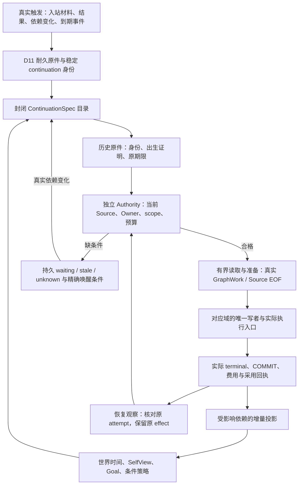
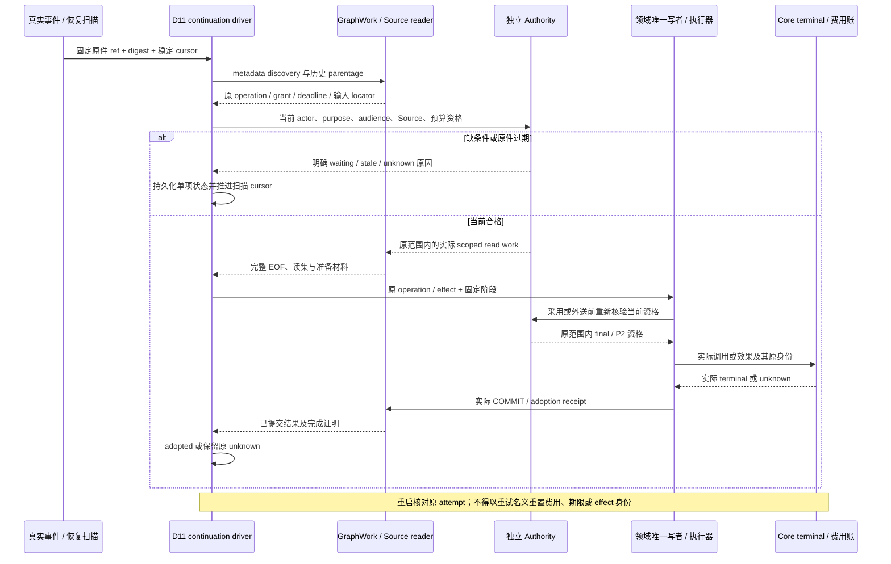
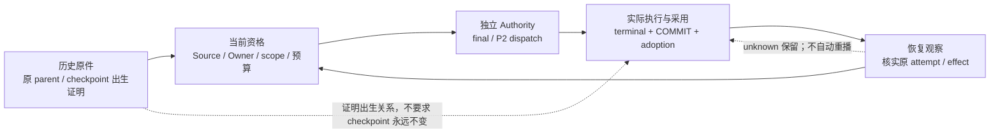
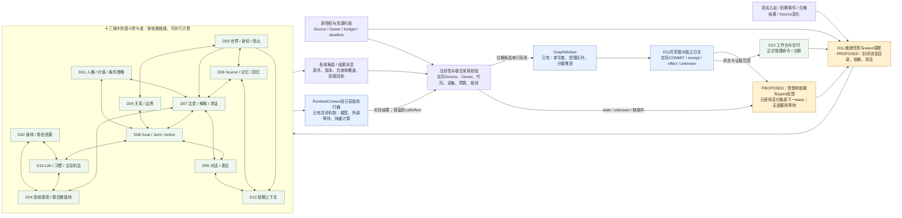

# Sylanne Beta1 深化架构提案

状态：**历史设计提案；已获用户批准进入 Beta1 实施，未获得生产验收**
日期：2026-10-14（Asia/Shanghai）  
范围：保存完整十三章设计，作为下一轮源码接续与评审依据；本文件不是产品实现或运行回执。

建议 Beta1 采用“事件驱动、增量维护、有界推理”的主路线：先把已批准的生产链补成真正可恢复的闭环，再让世界、自我、目标和策略在同一套证据与时间模型上持续变化。深度来自更准确的状态、依赖和行为选择，以及长期结果对后续行动的影响；不以增加常驻模型代理、无限反思或扩大默认资源额度换取复杂度。

本设计保留提出时的 Alpha2 基线和问题描述。后续 Beta1 实际实施状态见 [源码实施合同](../plans/complete-agent-20261006/beta1-full-source-contract.md)，不改变任何生产资格。已实读 `implementation-state.json` 中的 **283 条 `audit_mapping`**；其旧状态、行号和哈希仅用于需求定位，不作为当前代码或运行通过证据。以下需求编号是深化重点映射，不意味着其余需求失效，也不是 283 项重新验收完成。

既有规格依据：

- [十三域设计索引](sylanne-3-design-index.md)
- [公共协作合同](module-collaboration-contracts.md)
- [十三域总装](sylanne-3-thirteen-module-coupling.md)
- [283 项实现状态与 audit_mapping](../plans/complete-agent-20261006/implementation-state.json)
- [v3 实现合同](F:/下载/Sylanne-local-implementation-prompt-v3.txt)

Alpha2 检查点已于 2026-10-14 推送到 `https://github.com/2718labs/astrbot_plugin_sylanne` 的 `codex/alpha2`：本地与实际 ls-remote 均为 `5f053929bb2847c6b8717ad384e39c952ce87a0a`，tree 为 `c4184e1f5e2b50fdb4cab0344a4ac8d6cca69ed9`。首次自动审批拒绝原件保留；用户明确确认具体仓库后，正常推送执行成功。没有 PR、合并或发布。Beta1 在独立本地 `codex/beta1` 接续，未推送，整体资格保持 HOLD。

包体预算采用最新要求：理想约 **15,000,000 字节**，硬上限 **16,000,000 字节**；小于目标不填充。高资源 tier 仅属提案，现有 2CPU/2GB 基线继续适用。**PROPOSED 设计、源码已实现、编译通过、安装验证、真实生产资格以及“史无前例”的新颖性证明是不同状态。本文只完成第一项。**

## 1. Contact 与 D07 接续提案的审查结论

Contact rev2 没有发现本轮有限审查范围内明确的 P0 伪会话或绕过 P2 的路径；它补上了独立 Core observation 读取，Graph background invocation 与 Owner session invocation 也保持分离。但有两个 P1，必须在 Beta1 接续时修复：

- **新 Core capture 没有真正接入当前 V3 存储读取。** 新 RPC 直接打开 SQLite 后调用 `read_contact_background_inputs_v1 → read_adopted_contact_plan_v2 → require_current_contact_plan_members_v2`，末端仍查询 `graph_atoms.value / graph_history.value`。当前 V3 物理表使用 `value_cell_id`，新路径没有实际 SourceMaterial/GraphWork 绑定。应由正式 `current_authority_graph_read_v3` 的 Contact selector 和真实 installed controller 完成 metadata、权限、完整 EOF 与分段正文读取；不能增加兼容 DB 代理。Contact 代理已按此方向接续 rev3，但开始修订不等于修复已验收。
- **历史失效 Plan 可以阻断整页恢复。** 扫描页在逐项交给 driver 之前就对每个历史 Plan 做 current 校验，任一旧 Plan 失效会使整页失败，下一次又从空 cursor 开始。稳定 metadata discovery 必须与逐项 current qualification 分开，失败项持久记状态并推进游标，剩余项继续被发现。

D07 完整 proposal 已发现并回传三个 P1：

- 新反思原件、parent 校验和准备 callback 仍直接查询旧 `value` 列，未闭合 V3 分段存储入口。
- reflection C3 descriptor 永久要求 checkpoint 保持原 revision/digest 和 `continue`。真实反思采用会更新 checkpoint，随后 completed attempt 的 call-plan 观察反而拒绝该合法结果。必须区分 **不可变 parent/checkpoint 出生证明**、**执行前 current 资格**与**执行后实际采用证明**。
- 反思恢复只扫描前 16 项；当这些项全部过期或等待且没有作业被唤醒时，不继续下一页，后面的合格项可能永远未被发现。

保存本提案时新增一项待闭合边界：Contact 的共享 currentScope/Plan 读取也被 `AuthorityV2ModelEgressService → CurrentModelGraphVerifier(kind=model)` 使用。现有 model entry 对非 natural Contact 直接校验，却不具备 Contact SourceMaterial。修复 background RPC 的 V3 入口不能被描述为 model egress 同时获得资格。

拟议最小接口须分别绑定 background observation 的实际 installed service 和 model egress 的实际 installed ContactModelResultService。后者需绑定真实 intent、job、call-plan、Source policy 与原作用域；不能借 background selector、伪造 RuntimeContext 或借默认 grant。主协调者已明确将独立 ModelContactReadSelector/Work 纳入 Beta1 的 Contact 生产闭合范围。未完成时的 HOLD 只是如实表示缺资格，不能成为最终完成状态或替代实现；真实付费与发送仍须各自原有资格。

Model Contact 的 B1 具体源链与接口约束如下，均为下一轮实现设计：

1. **实际服务注册。** model admission 沿用真实 `AuthorityV2ModelEgressService` 与 `PinnedCurrentModelEgressGraphVerifier` 的 controller，登记它们与实际 `InstalledContactModelResultServiceV2`、Contact policy service、Core/fences、Control、选定 Graph 的配对。model dispatch 和 result read 各有实际 Work 与 permit，不借 background selector/Work。
2. **封闭 selector。** 从实际 job 与 Contact prepared metadata 派生 `ModelContactReadSelector`，绑定 namespace、contact_id、phase、job_id、intent/call、prepared ref/digest、prepare COMMIT、acquire intent/receipt、root grant、signed quote、reservation、policy original，以及实际 actor/purpose/audience。caller 提交的 contact_id 不能单独成为授权。
3. **阶段边界。** 采用 actual job metadata → 纯 locator → 原身份与独立 current policy/Owner → current Source family/rights → Source 正文与受保护 Plan/frozen/request 完整 canonical EOF → current model semantic validation。Plan 原件中的 expression、frozen/request 都可能含正文，不能为了取得 selector 就提前全量解析或暴露；locator 必须由已有正式 metadata 机制取得并在完整原件 EOF 后回核。如果现有 schema 没有合格 locator，则新增窄同事务原件，并实际接齐 migration/C09/cold reader，不能使用未验证 JSON 值自授范围。
4. **model policy 的真实入口。** 当前 `d10_contact_policy_service_v1.read_current` 调用 background Owner reader；`d12_target_owner_admission_v1` 和 `v2_owner_ticket_store.get_current_guard` 明确只接受 read/write fence，因此不能把 model_egress permit 直接传入。应增加只接受已注册 actual ModelContact Work 的内部 model policy/Owner observation，校验原 admission permit 与 Core intent、subject/holder/namespace/anchor，复用真实 D12 当前 location/head/principal/迁移或 storage lineage 核验。公共 read/write permit 规则保持原义；不伪造 read fence，不扩大通用允许集合。
5. **Core 与 Graph 边界。** policy/Owner 原件在 Graph quantum 事务之外观察，进入 protected data 前与最终消费前复核同一 Work/pins。现有 `require_contact_policy_current_v2` 的直接 Core transaction 与全 policy 扫描应改为消费真实 Work 中按精确 policy id/ref 取得的观察。Graph callback 不另开 Core transaction，也不以安装服务类型本身替代当前调用权限。
6. **Source 与模型用途。** Contact 的 D06 Source qualification 使用实际 expression purpose/audience；模型 envelope 的 proposal 用途另外校验。正式 Contact Source selector 不伪造 D07 focus/ticket；根引用来自实际采用 Plan，祖先、正版本、负查询和 correction/删除范围完整闭合。
7. **出生、当前、结果与恢复。** 历史 Plan/prepared/call 的 canonical EOF 证明签名出生 bytes/digest；current SourceMaterial 证明今天仍可使用的 Source/rights/正文。prepare/acquire/dispatch 严格核对当前 running job、lease 与 reserved 预算；已执行结果核对实际 terminal、paid cost、真实 reservation state 与原 read_attempt/call，不要求历史 job 永久 running 或 reservation 永久 reserved。恢复保留 unknown 且不生成新 effect。
8. **结果读取也必须闭合。** `InstalledContactModelResultServiceV2._graph_read` 当前仍直接打开 SQLite 并读取旧 value，必须改用该实际结果服务的独立 read Work，绑定真实 read permit/read_attempt 与原 intent。前后 Core terminal 观察与 current Source/policy 复核连接同一实际 Work/stamp；Work 不私自结束调用者的原 fence。
9. **预算与期限。** Work 只使用原实际安装 meter；deadline 取原 job、lease、plan、policy、request、root grant 的适用最小值。模型默认 1 在途、单次原费用与 unknown 风险账不复制、不刷新，不新增真实付费授权。

这些设计有当前源码读取依据，但没有在本次文档工作中实施、编译或运行；最终闭合必须由实际源码与对应必要验收证明。

两份提案继续保持 **Beta1 proposal/HOLD**，不并入 Alpha2 检查点。这些问题说明 Beta1 应先解决下面的公共机械机制，避免每条功能链再次各自实现一遍。

### 一般 Life 成长的完整 B1 范围

实际事件 `actual_life_outcome_available_for_growth` 目前进入 D01 固定等待；Method 的 ST0→ST2 专项不能替代一般人格成长。B1 拟用专用 LifeGrowth continuation 接齐：真实 D10 progress/terminal/cost/采用原件核验 → 已预登记 trial 的结果归档，或新成长调查 → D07 正式 attention issuance、公平 ticket 与真实 paid lifecycle → 已采用解释冻结成长提案 → 具体未来计划/effect 的事前 trial → 当前反证、连续性和政策核验 → 既有 D01 唯一采用者 → D08/D10 后续实际消费者。

Life internal/same-root 经历保留其来源资格，只是真实触发或试验结果，不改成独立外部 Source。普通与深层自然成长的 observed/confirmed/independent 支持门保持；失败、取消和 unknown 在整体 trial 记录中保留。新 GeneralGrowthTrialStart 与 D07LifeGrowth question/prepared 使用封闭版本，旧签名 bytes 不改；当前反证重新核相关 scope 的完整覆盖，旧反证仅证明出生检查。

该链须同时具备 V3 分段 Work、纯 locator、Source 权限与祖先闭包、原件 EOF、同实际 CAS authored successor、post-commit 原件、撤权/删除、迁移/C09 和重启恢复。不能给旧只按 project 匹配的 trial 偷补曾经绑定 effect，也不能凭一次 Life 成功直接采用人格。上述是待实施合同，不是当前已经通过的功能。

## 2. 三条路线与推荐取舍

| 路线 | 做法 | 优势 | 主要代价与边界 | 建议 |
|---|---|---|---|---|
| A：事件驱动的增量证据图 | 保持现有 Graph/Authority；增加统一的有界 continuation、依赖唤醒、历史/当前观察分离；各域继续独立采用 | 能直接修复实际断链；易控制空闲成本、恢复和局部更新；适配 2CPU/2GB | 必须严格维护事件身份、依赖和消费完成条件 | **作为 Beta1 主线** |
| B：声明式领域工作流 | 把固定阶段、读集、原件、预算、恢复规则编译为封闭的执行目录 | 减少重复接线和漏注册；便于从 283 项追踪到真实入口/消费者 | 若做成通用规则语言，会扩大解释器和权限面 | **只吸收机械目录与构建期检查，逐步加入 A** |
| C：统一的长时规划与模拟服务 | 在显式项目 scope 内维护计划搜索、多个反事实分支和预测校准 | 适合更复杂的项目选择、依赖和条件策略 | 成本与未建模因素更难控制；最易形成“多想即获得新事实”的误用 | **作为后续受限能力，不能替代 A 的生产闭环** |

推荐组合是 **A 为运行骨架，B 负责减少机械遗漏，C 只在获准任务中提供有界候选**。不建立 D14 总代理，不让一个规划器写所有域，也不部署十三个常驻 LLM。

以下图示是机制关系提案，箭头不表示当前源码已经接线完成。



图中的反馈边继承原因果根与原资源账，不构成自动生成新授权的循环。

## 3. 先统一续作协议，保留每个域的业务判断

D11 增加或收敛一个封闭的 `ContinuationSpec` 目录，描述实际已有作业如何继续。它只统一机械部分：

- 固定触发类型、生产者和消费者。
- 实际输入原件的 locator schema。
- 使用的 current read recipe。
- 正读、负查询覆盖和失效依赖。
- 调用哪个已注册域写者。
- 是否产生付费调用或外部效果。
- 恢复入口、最终完成证明、取消与等待条件。

目录不是可执行的用户脚本，不接受任意函数名、callback 或表达式。所有业务决定仍由 D01–D13 的既有写者作出。构建时检查“能产生事件却没有消费者”“新 durable table 没有 C09/migration codec”“有 prepare 而没有 terminal/recovery 入口”，运行时不做源码扫描。

拟议的 durable continuation 至少保存：

| 字段组 | 必须表达的内容 |
|---|---|
| 身份 | `namespace、continuation_id、causal_root_ref、trigger_original_ref/digest、recipe_id/version` |
| 范围 | 原 Owner/standing policy 引用、purpose、audience、activation/storage generation、scope commitment |
| 输入 | 原件 refs、固定选择器、positive read versions、negative query coverage、Source closure commitment |
| 作业 | 稳定 activity/effect/operation、当前 phase、已有 job/call/attempt refs |
| 资源 | 原 parent lease/grant commitment、已用与未决费用引用、原绝对 deadline |
| 停止 | cancel generation、精确 `wait_predicate_ref`、terminal reason、禁止重放的 unknown footprint |
| 完成 | 实际 child receipt refs 和完备性证明，不能由“函数返回”替代 |

状态使用 `discovered → qualified → prepared → executing → observed → adopted`，并分别允许 `waiting / stale / cancelled / unknown / terminal_failure`。这只是软件控制状态，不改变 D04 的连续感受机制。

稳定身份从真实因果原件、固定阶段和具体效果派生。Graph epoch 改变可以产生新的**观察尝试**，不能因此给同一个效果分配新的 operation/effect，不能刷新原授权 TTL，也不能重置已花预算。

长期成长调查还须区分三层：durable tracking intent 保存原因果根、tracking policy、跟踪有效期和取消代际，本身没有持续执行权；每个新的业务阶段有不可变 StageAdmissionOriginal，绑定固定 stage slot、真实前驱 receipt、当时有效的 standing policy/parent grant 与预算；具体 job/call/effect 延续自己原签发期限和身份。跨天等待不会延长旧 job，也不能以新阶段名义重放超时或 unknown 的旧效果。未来独立阶段只能沿正式当前授权入口签发，并保留与旧阶段的明确关联及全部费用。

例如：原 Life L1 完成并触发调查，C1 认知在短期授权内完成；未来 trial T1 在执行前冻结具体计划/effect、观察规则、RoleClock 和窗口。跨日 Life L2 有独立实际授权与费用，完成后由当前合法观察 O1 核原结果，再分别取得 C2 连续性判断和 A1 采用资格。所有阶段共享因果根，L1/C1 原件不变。试验发生时刻、核验时刻和采用期限分别验证；迟到观察不能延长原提案或政策的采用期限。



阶段事务不能把旧 READ scope 伪装成新的 WRITE scope。准备材料应绑定明确读集、epochs 与版本；正式采用仍由实际新写事务核验对应 stamp 和当前 Owner。失效时重新准备原作业的数据，不能生成新的效果身份或延长授权。

## 4. 双时态世界：能回答“当时发生了什么”和“当时知道什么”

D03 已有 `occurred/learned/received/committed` 方向。Beta1 将其落实为可查询的双时态版本，而不是再建一份世界数据库。

拟议 `WorldAssertionRevision` 保留：

- 稳定实体/事件/命题身份。
- `valid_interval`：该陈述所指的事件有效时间，可开放、模糊或有精度。
- `known_from_sequence` 与被后继版本取代的序号：本角色从何时获得该材料。
- `occurred_interval、learned_at、received_at、recorded_sequence`。
- `origin_kind、reality、assertion_status`，以及独立的 Source refs 和引用/否定范围。
- `supersedes_ref、correction_ref、dispute_refs`。
- 当前用途、受众、删除与访问依赖。

原始签名材料不因“结束旧有效期”而原地修改；后继版本和投影表达取代关系。D11 维护索引和事务，D03 维护世界身份与时间语义，D07 仍是信念/解释的唯一采用者。

`WorldViewRequest` 显式带 `event_time_as_of、knowledge_as_of、perspective_ref、purpose、audience、coverage_bound`。历史查询也必须满足**今天仍有效的 Source 权限与删除状态**，不能恢复过去曾有但现在已撤销的权限。

行为效果是可检验的：

- 迟到澄清可以更新今天的解释，但不让昨天的角色拥有今天才得到的知识。
- 同一事件的“用户当时报告”和“后来独立确认”保留不同证据资格。
- D08 使用的期限保持协商版本，不因系统时区变化而改约。
- D09 的“当时我以为……”来自真正的历史视角，不从当前真值反推过去台词。

索引首先支持稳定键、时间分区和有界 keyset 查询。只有满足索引条件的点查/分页可按 `O(log N + k)` 讨论；任意双时间范围与复杂条件仍可能扫较大集合，因此必须保留覆盖、水位和续接，不能承诺所有时间查询都是对数复杂度。

对应重点：`D03-R03/R08/R09/R10/R11/R12/R14–R18`、`D07-08/09/11`、`D08-R17/R28`。

## 5. 自我模型：稳定身份、能力判断和语义成长分开

D01 保持 `RuntimeIdentityRef` 的稳定运行身份，与可修订的 `SemanticIdentityRevision` 分离。Beta1 在 D01 的可重建 SelfView 中明确区分：

- **身份与价值**：当前已采用的身份语义、价值偏序及连续性依据。
- **条件能力判断**：例如“在材料充分、工具允许、期限足够时，某类任务通常能完成到哪一步”。
- **当前限制**：由 D02/D11 的授权投影提供可用性，不把技术余额、秘密凭据或诊断真值直接灌给角色。
- **自我解释候选**：D07 提出的偏见、习惯或原因假设。
- **感受自我理解**：仍由 D04 采用，允许落后于实际感受。
- **未来承诺与未完成事项**：引用 D08 的真实责任，不能因人格修订消失。

拟议能力记录不是一句常驻自我评价，而是：

`task_class、condition_predicate_ref、scope_refs、support_family_refs、counterexample_refs、verified_outcome_counts、unknown_count、last_review_ref、valid_until、qualification`

能力变化绑定事前预测与事后实际结果；未知结果保留在未知计数中，不能从分母删除来制造成功率。样本不足时输出有限判断，不拿模型自评分当校准值。

D07 可发 `self_discrepancy_observed`，D01 可生成条件化修订候选，D08 决定是否值得进行既有授权内的低风险试用。候选本身不是采用命令；本方案不让 general consumer 新增自动 `adopt_growth` 路径。D01 既有、明确授权的 adopter 继续是唯一采用入口。

对应重点：`D01-R01/R04/R05/R07–R12/R18/R19`、`D07-03/08/10`。

## 6. 有限反思与一般成长：把“有进展”和“应该停止”做成可核对事实

反思只由真实触发启动：新外部材料、实际结果与预期冲突、已采用解释中的未解决槽位、明确的价值冲突，或已授权的项目观察。内部派生事件继承原 `causal_root`，不能靠再发一个事件重置预算与深度。

拟议 `ReflectionCheckpoint` 除现有字段外，以版本化形式绑定：

- `parent_execution_ref/digest、trigger_ref/digest`。
- 初始与当前 unresolved slot 集。
- 实际查看过的 discriminating refs。
- 已排除或收窄的假设及对应 evidence refs。
- 原 ticket/group、fair-round commitment。
- 已消费的 call refs、实际费用、父预算与原 deadline。
- `stop_reason、next_wake_predicate_ref`。

判断进展由固定校验器根据已采用输出和真实引用计算，例如某个缺口被证据闭合、某个歧义被明确缩小、某个未知被正确转成具体求证动作。模型自行宣称“我想得更深入了”不算进展。

保持既有上限：同因果根最多两层元反思，共享辅助调用额度。无新信息、无可证明进展或资源不足时，保存状态后等待具体事件。等待不额外调用 LLM。

实现上必须分开三种观察：

1. **历史 parentage**：父调用、原 checkpoint、原预算与原授权确实存在。
2. **执行前 current 资格**：checkpoint 当前允许继续、Source/Owner 有效、fair ticket 实际轮到、期限和额度足够。
3. **完成后结果证明**：这个子作业确实更新了 checkpoint，并有实际 paid terminal、adoption receipt 与历史成员对应。不能继续用第 2 项的旧 checkpoint revision 拒绝第 3 项的合法输出。

一般成长分为两条可组合出口：

- **已预登记试验的结果归档**：Life/action 实际结果到达后，验证其原 trial start、原计划、观察器、时间与费用，生成真实 trial original。
- **新成长候选形成**：D07 产生有来源的局部或深层解释，D01 构造支持/反证/作用域/试用/连续性候选。内部想象、回忆与模拟不升级为新的独立外部证据。

深层身份成长继续要求既有 plasticity policy、独立证据家族、有限试验与连续性。新出现的反例优先收窄适用条件；不默认把一次失败上升为全局人格否定。

对应重点：`D07-01/04/05/10/13/14/17`、`D01-R01/R03/R07–R10/R14/R16/R19`、`D10-R20`。

## 7. 长时 Goal、Joint 与习惯：长期存在不等于长期持有执行权

D08 保留 Goal 的稳定身份、可观察满足谓词、可控程度、承诺和历史结果；D10 拥有执行安排、occurrence 和习惯运行。长期目标可以跨会话存在，但每次实际执行仍需当前有效的原范围与预算。

计划采用“里程碑 + 最多 8 个可执行节点的当前窗口”，每轮最多 6 个候选。窗口以外可以保存非执行性的方向和依赖，不能提前给无限步骤签发资格。

Joint 节点使用不可变、content-addressed 的 typed execution binding。优先通过现有 `PlanNode.resource_ref` 关联，令已确认的 terms 自然覆盖完整参数承诺；不向旧 V1 intent 随意加默认字段而改变旧签名 ABI。

节点绑定必须覆盖：

`plan_ref/revision、node_id、party_scope、executor_kind、typed_request_ref/digest、goal/project/recipe/target/source refs、predicate_ref、parent_grant_ref/digest、original_deadline、cancellation/compensation refs`

节点记录分开 `planned / ready / active / waiting / predicate_satisfied / failed / cancelled / unknown`，其中 `predicate_satisfied` 的证明类型必须保留。消息 accepted、artifact 存在、对方确认与本机 `completed_verified` 不是同一个结果。

外方节点不伪造本 persona 的 ActionIntent、CPU 劳动或 `completed_verified`：

- `explicit_confirmation / recipient_acknowledged` 可由真实 D03 主体绑定、inbound Source 与精确 D07 解释形成 D08 的外部节点观察原件。
- 它满足的是事先约定的确认谓词，状态应保留 `externally_confirmed` 语义。
- `artifact_verified / action_postcondition` 仍需指定观察器的真实证据，不能退化为口头确认。

习惯分成 D01 的条件策略与 D10 的执行安排。拟议 `HabitExecutionPolicy` 保存 cue predicate、许可的 recipe、时窗、最小间隔、每窗口上限、原授权引用、miss policy 与停止条件。未发生的 occurrence 不补造经历；错过日程可跳过、等待新窗口或请求重新安排，取决于已有政策。缺席不产生惩罚或关系扣分。

具体 wake 由 D11 的持久订阅与最近到期 timer 负责，D08/D10 不再各建调度器。新 occurrence 只能从仍有效的 standing schedule/grant 正常派生；不能把过期旧任务改个 deadline 继续运行。

对应重点：`D08-R01/R04/R05/R08–R11/R14–R20/R27/R28`、`D10-R03/R04/R08/R09/R11/R17/R18`。

## 8. 条件策略与反事实：让长期学习改变行动，保留未知与归因边界

D01 的策略是带条件的偏好边，不是隐含权限：

`strategy_id/revision、condition_predicate_ref、preferred_method、alternative_method、applicable_scope、support_families、counterexamples、trial_refs、exclusions、rollback_predicate_ref、validity`

D07 只判断当前条件是否匹配及覆盖是否完整；D08 先做硬资格过滤，再使用 D01 偏序、D02/D04 当前读出和真实成本比较候选。

当收益或代价区间重叠时，保留并列/未知，或在原预算内精修。不能用模型自信填补数值误差，也不能让更强烈的情绪越过硬条件。

反事实任务保留冻结的 `baseline_snapshot_ref`、改变的假设、未建模因素与 stopping rule。维持基准加最多两个替代分支、每分支最多两步预测。分支结论只能是 simulated，不写真实事件、责任、关系贡献或完成事实。

拟议 `PredictionRecord` 将事前预测与以后真实结果配对：

`prediction_id、branch_ref、target_observable、predicted_range/category、assumptions、resolution_rule、expires_at、resolved_outcome_ref、calibration_status`

预测准确度可用于 D01 评估某种策略的适用范围，但单次相关性不构成因果结论。方法学习的收益仍需既有 Full/NoStrategy/NoEpisode/NoLearningHistory 隔离比较，事实、权限和预算在各分支相同；不能把预期策略写进另一分支提示中泄漏答案。

这里的可实现改进是：把“经历 → 条件 → 方法选择 → 实际结果 → 反例收窄”做成完整记录和消费者。它是否比当前策略更有效，必须通过冻结协议的比较建立，不能预先宣称。

对应重点：`D01-R04/R08/R09/R19`、`D07-06/08/12`、`D08-R06/R10/R21`、`D06-07/18/20`。

## 9. 可证恢复与观察：所有新能力都必须有同等级的恢复入口

本轮 V7 和 Contact/D07 审查暴露的共性，是“当前资格、历史原件、执行结果和恢复证明”容易被一段大函数混在一起。Beta1 应建立固定的四层证据与一个独立执行闸门：

| 层 | reader / 语义 | 能证明什么 | 不能替代什么 |
|---|---|---|---|
| 历史原件 | `HistoricalOriginalRead` | 原件、签名、出生事务及当时身份 | 当前 Source/Owner 使用资格 |
| 当前资格 | `CurrentQualificationRead` | 现在的 Source、Owner、scope、代际、预算和期限 | 实际执行、COMMIT 或采用事实 |
| 采用与结果 | `CommittedResultRead` | 实际 COMMIT、成员、费用、输出与 adoption receipt | 原操作可再次执行的授权 |
| 恢复观察 | `RecoveryObservation` | 在当前资格下核实原 attempt、permit、terminal 与结果 | 重新执行或清除未知风险 |
| 独立执行闸门 | `DispatchQualification` | 独立 Authority 与既有 final/P2 协议签发的本次执行资格 | 上述各层原件与实际结果 |

四层不是四套数据库，而是 reader 类型、证据责任与调用位置。共享的是分页、EOF、哈希、实际 reserved meter 和当前位置绑定等机械部分，业务验证继续由对应域承担。



反思采用会推进 checkpoint。完成后核对的应是“该子作业是否产生了合法采用结果”，而非要求执行前 checkpoint 永远仍为 `continue` 且 revision 不变。历史不可变 parentage 与当前可变状态必须在 API 和数据上都可区分。

新 schema 的准入清单必须同时包含：

`producer、normal_reader、historical_reader、current_reader、C09_classification、source_closure、migration_codec、cold_recovery_consumer、package_registration`

缺任何一项不能把新功能标为生产完整。尤其不能出现新 Core 表只有写入没有读取，或者 Graph 保留签名副本却没有独立 Core 对照。

所有恢复页使用稳定游标。单项失效只影响该项；当前页全部不合格也必须继续下一有界页直至本轮 EOF。完成本轮后等待实际依赖变化，不从第一页无限轮询。

D12 展示“为什么等待、等待什么真实事件、最后核验的原件范围、费用是否已知、是否存在外部 unknown”。角色对话只拿适用的有限语义投影，不读取完整诊断或隐藏推理过程。

## 10. 资源、背压与缓存

下表保留既有资源目标与 v3 明文提出的待测配置建议；目标、工程分配和实际测量分开，不能把建议写成已经实现的限制：

| 项目 | Beta1 基线 |
|---|---|
| 整机约束 | 2 CPU、2,000,000,000 字节；不能替换成 2 GiB，也不能排除 Authority/Host |
| 应用组 | 原 1280 MiB 预算、1024 MiB 软阈值；是否满足以真实进程组测量为准 |
| Graph | 1 个写者；运行队列保持 8 项上限，同时限制队列字节数 |
| 重计算 | 1 个重计算 worker，保留现有数值资格与原期限 |
| 模型 | 默认 1 在途；未知结束仍占风险/费用槽；默认真实付费额度 0，直到存在适用授权 |
| 调度 | 事件通知或最近到期 timer；无输入、无进展时 0 LLM 轮询 |
| 热缓存 | PROPOSED：沿用 v3 明文的 64 MiB 投影热缓存待测起点；具体分配及完整进程组峰值须经实现与测量确认 |
| D13 | 保留原 8 MiB、256 块、72h 边界；不因命中或读取续命 |
| C09/GraphWork | 使用实际安装的 records/bytes/time/arena caps，不扩大或另造 meter |

工作队列只放有限 locator、digest 和阶段，不放 prompt、模型响应或整棵快照。可采用不超过 8 KiB 的新 queue-item 编码上限作为工程提案，完整正文留在正式分段存储；Python 容器开销仍计入应用组与实际 arena，不把编码大小当总内存。

资源不等式必须由实际账本检查：

```text
child ceiling <= parent remaining ceiling

child deadline <= min(
    original scope deadline,
    grant expiry,
    workflow deadline,
    required source/policy expiry
)
```

现有 route 可能比 v3 文档里的 12k/2k 起点更小，例如已安装 V7 的窗口。每次采用所有相关限制的最小值，不用 Beta1 新规格放宽已装容器。已有 absolute deadline，包括适用路径原 600s 限制，不因新 continuation、观察重试或宿主工具循环重新计时。

背压按语义处理：

- 停止/撤权、执行 unknown 核对、最终 ACK 等必要工作不被可选反思排在后面。
- 可选 projection rebuild 合并同一依赖的新版本；不能合并不同 effect 或抹掉必要义务。
- 已接纳入站须先耐久保存，再排队；队列满只延迟消费，不能报告已接受后丢消息。
- 前台有可运行工作时，后台不新增模型 admission；已在途调用的取消仍以真实 terminal 为准。
- unknown 风险账不得因缓存 TTL 或进程内清理消失。

缓存键使用输入与政策的语义版本、purpose/audience、Source closure、访问/删除代际和相关查询覆盖。缓存命中不免除外送/采用/发送前的当前授权检查。正结果、负结果和未完成覆盖分别缓存；“这一页没找到”不能缓存成全局不存在。

增量更新只重新处理受影响的依赖子图。局部事件的期望成本是受影响节点数，而不是全图大小；最坏情况仍可能触及大量节点，必须分页续接。对 D04 数值块，只在已有证书允许时复用状态或误差界；否则继续原合格重算路径。

高资源 tier 仅作为后续配置提案。它必须有明确安装 profile、资源测量、Owner 授权和新 signed grant 才可启用；不能由队列压力、模型建议或“Beta1 模式”自动升级。

## 11. 可维护的源码组织与包体

不建议继续把每条新功能塞进 `graph_coordinator.py` 或一个巨大的 Authority rebase 文件。针对本轮触及的路径，按以下边界逐步拆分：

- 纯 typed contract/codec。
- 固定 read recipe 与实际 storage work。
- 当前资格 issuer。
- 领域 staging/adoption。
- durable continuation driver。
- 历史/恢复/C09 consumer。

GraphCoordinator 保留装配、单写者与事务入口；不复制领域判断。共享库只提取确实相同的 meter、分页、完整 EOF、签名原件定位和提交机械逻辑。历史/当前资格、不同签名 schema、不同域结果不做“万能 fallback”。

包只包含可安装运行所需的 Python、目标平台 native 库、构建后的 UI、必要 schema/模板/迁移器及许可证。排除测试、证据包、开发依赖、缓存、数据库、凭据、模型权重、调试符号和重复平台构件。每个平台构建独立包，必要外部依赖单列体积与版本。

采用确定性的组成清单：每个文件有用途、producer、使用入口、平台、压缩/解压字节数和 hash。静态 import reachability 只是检查之一，动态注册项还要由固定目录显式覆盖；不能为凑体积删掉实际需要的冷恢复 decoder。

目标是 **不超过约 15 MB 的正常构建、16,000,000 字节 ZIP 硬门**，不是必须达到 15 MB。若必要实现超上限，先给真实组成与取舍，不填充、不隐藏依赖、不删除必要机制冒充完整。

AstrBot SDK 的正式依据与使用边界如下。官方文档在本轮已读取；主协调者另已读取本机 SDK 4.28.1 API 签名。**文档描述和本机签名读取都不证明用户目标 Linux / AstrBot 4.28.2 已安装运行通过**，后者尚未实测，需 B5 形成具体资格。

| 官方来源 | 本设计使用的事实与含义 |
|---|---|
| [插件开发总览](https://docs.astrbot.app/dev/star/plugin-new.html) | 插件通过规定的项目结构与 metadata 声明宿主兼容性和平台支持；生命周期及热重载要求插件释放其持有资源。声明兼容范围只表达适用意图，不能替代目标版本运行验证。 |
| [简单插件与生命周期](https://docs.astrbot.app/dev/star/guides/simple.html) | 插件以 Star/Context 接入宿主，事件处理采用异步入口，并通过终止钩子清理资源。Beta1 的 timer、订阅、worker 与在途账必须服从实际插件生命周期，不能在卸载后留下活动写者。 |
| [插件配置](https://docs.astrbot.app/dev/star/guides/plugin-config.html) | 配置 schema 可供宿主提供配置界面。资源 profile 可使用该入口表达，但 UI 配置变更本身不产生 Owner 授权，也不签发新 scope 或预算。 |
| [模型与工具能力](https://docs.astrbot.app/dev/star/guides/ai.html) | Context 提供当前会话 provider 获取、模型生成以及工具/Agent 接入能力。正式适配需核对目标版本的实际签名与终止语义，并将每次模型与工具效果接入独立 Authority、原 call/effect 身份及费用账。 |
| [消息发送](https://docs.astrbot.app/dev/star/guides/send-message.html) | 主动发送可通过 unified message origin 与消息链调用宿主发送接口；平台支持存在差异。会话 locator 与 API 返回均不能自动等同收件人确认或真实交付完成。 |

宿主默认模型/工具循环只提供能力调用机制，不能绕过独立 Authority 的 scope、Source、预算、deadline、外送和 P2 规则。循环中的每次工具调用与后续模型调用都必须延续原因果账，并取得对应当前资格；SDK 的便利入口不能成为另一个未记账的执行器。插件热重载只能恢复原 continuation/attempt，不重发 unknown 外部效果。

## 12. 分阶段实施与 Alpha2 → Beta1 迁移

| 阶段 | 实施内容 | 必须得到的结果 | 不能据此宣称 |
|---|---|---|---|
| B0：基点 | 固定实际 Alpha2 source/manifest/schema/native/UI 指纹；独立分支与恢复材料 | 可追踪的 Alpha2 检查点、Beta1 before/after 基线 | Alpha2 全部 283 项已验收 |
| B1：续作与原件 | 修 Contact/D07 P1；接 Joint/Life 固定消费者；统一完整分页、current/history 分层、新 schema 全注册；实现独立 ModelContactReadSelector/Work 与 model/result policy、Source、原件、恢复闭环 | 有资格时实际推进；缺条件时准确等待；重启找到原作业 | 真实平台、付费模型、C09 已通过 |
| B2：时间与 Self | 双时态查询、当前失效传播、SelfView 与条件能力记录 | 不泄露未来知识；纠错改变当前判断；身份与权限分立 | 人类心理真实性或意识 |
| B3：长期目标 | Joint 完成证明、外方观察、里程碑窗口、习惯 occurrence | 跨会话项目真实推进；停机不补造经历；未知不重播 | 所有外部后果 exactly-once |
| B4：学习与反事实 | 条件策略、反例收窄、有限预测配对与一般成长提案 | 经历能改变真实行动次序，且保留归因边界 | 已证明优于所有已有方法 |
| B5：交付资格 | 安装/升级/恢复、包组成、2CPU/2GB 实测及目标宿主验收 | 对明确平台和能力给出实际资格 | 未测试平台或高资源 tier 可用 |

迁移使用已有独立 Authority 的唯一 activation generation：

1. Beta1 先读取 Alpha2 旧 schema，新增类型显式版本化，不改旧签名 payload。
2. 在隔离候选代际中建立新索引/投影并验证完整 Source、删除与执行水位。
3. 旧 live job 只按自己的 schema、原输入和原 deadline 恢复；不能把旧 prepared 原件自动转成新的付费调用。
4. 进入切换前先处理未决效果与在途账；原子切换后旧代际失去读取、采用和发送资格。
5. 新原件一旦写入，只有明确的双向兼容合同才能退回旧执行程序。否则保留 Beta1 reader 进行恢复或隔离诊断，不能拿旧业务数据库覆盖最新删除/执行日志。
6. 删除与 unknown 防重放约束单调前进，回退不会恢复旧权限、旧正文或释放未知占位。

回退应明确分为“切换前放弃候选”“切换后使用兼容程序”“只能隔离恢复”三种。不存在通用的“把目录换回 Alpha2 就安全回退”。

本轮需求映射沿用 283 条 registry 的域归属与编号。下表聚合前文已经列出的深化重点，同时说明未被点名域的约束位置；不是新建另一套验收真源。

| 领域 | 本轮深化或保留的职责 | 已列出的重点 req / 约束 |
|---|---|---|
| D01 | 稳定身份、条件能力、策略与成长唯一采用 | `D01-R01/R03/R04/R05/R07–R12/R14/R16/R18/R19` |
| D02 | 当前授权与可用性有限投影 | 沿用原 audit_mapping；不把技术余额或诊断真值直接灌给角色 |
| D03 | 世界身份、双时态、外方主体与 Source | `D03-R03/R08/R09/R10/R11/R12/R14–R18` |
| D04 | 连续感受与已有合格数值更新 | 沿用原 audit_mapping；不得由软件 continuation 状态替代感受机制 |
| D05 | 既有领域写者与协作边界 | 沿用原 audit_mapping；本提案不另立越权采用入口 |
| D06 | 经历、学习对照与证据归因 | `D06-07/18/20` |
| D07 | 解释、有限反思、策略匹配和反事实 | `D07-01/03/04/05/06/08/09/10/11/12/13/14/17` |
| D08 | Goal、Joint、候选比较和承诺 | `D08-R01/R04/R05/R06/R08–R11/R14–R21/R27/R28` |
| D09 | 以真实历史视角形成适用表达 | 沿用原 audit_mapping；不得从当前真值倒造过去知识 |
| D10 | action、occurrence、习惯和试验实际结果 | `D10-R03/R04/R08/R09/R11/R17/R18/R20` |
| D11 | 耐久存储、单写者、continuation 和固定恢复目录 | 沿用原 audit_mapping；新增 schema 同时登记 C09/codec/consumer |
| D12 | 核验范围、等待与 unknown 的诊断投影 | 沿用原 audit_mapping；角色仅见适用的有限语义 |
| D13 | 有界缓存及原失效规则 | 沿用原 audit_mapping；8 MiB / 256 块 / 72h 原边界 |

后续每项实际改动应回填原 registry 中的 producer、消费入口、实际文件/符号、验证证据与状态；不能把本表覆盖的编号批量标成 completed。

## 13. 收益如何验证，避免用复杂代码代替能力

Beta1 的可验证收益应围绕行为和实际工作量：

| 机制 | 观察指标 |
|---|---|
| 增量依赖与唤醒 | 每次局部更正读取/重建的节点与字节；无关事件造成的无效唤醒；空闲 LLM 调用数 |
| 双时态世界 | 迟到信息场景的历史视角正确率；未来信息泄漏数；期限/时区误改数 |
| 有限反思 | 每次调用真正减少的缺口；重复无进展调用；停止后是否只由合法新触发恢复 |
| 条件策略 | 实际 action/plan 次序、验证/询问选择、合格作品结果；反例是否收窄适用域 |
| Joint/习惯 | 前缀坏项不饿死后项；外方确认与本机完成是否分立；无未知重复效果 |
| 恢复 | 原 operation/call/effect 延续；费用不双计；ACK 丢失后的原件核验；新旧代际不双活 |
| 工程效率 | 同进程组 memory peak、CPU、事件循环阻塞、队列字节、P50/P95/P99、本地/远端耗时分别报告 |

以原 XP-A/B/C/D 为纵向主轴，每个新增机制只补与其风险对应的必要验收，不再堆重复或镜像实现的测试。先编译和静态契约闭合，之后由真实安装包建立本地链与服务器资格。具体性能阈值应在基线测量后、比较前冻结；这里不预报百分比提升。

下一轮具体手工验收应以必要场景为界，并在适用授权与隔离资料上进行：

1. 在实际 V3 分段库上走 Contact/D07 的正式 current read work，确认不再访问旧 `value` 列，protected data 由实际 Source closure 与 EOF 限定。
2. 构造历史失效项位于扫描前缀的受控资料，检查稳定 cursor 能到达后续合格项；空页或整页 HOLD 不等于全局 EOF。
3. 完成一次实际获准的反思采用后读取其 completed 结果，确认出生证明仍有效，且不会因 checkpoint 合法推进而被旧 `continue` 条件否定。
4. 对已存在的 attempt 模拟 ACK 丢失或受控重启，只观察原 terminal/COMMIT/费用；unknown 必须保持，不允许触发新效果或新收费身份。
5. 在用户目标 Linux / AstrBot 4.28.2 上核对安装、生命周期、平台主动发送和模型工具适配；分别记录 API 接受、实际 terminal 与收件人确认。无真实授权时付费/发送资格继续 HOLD。
6. 用目标平台正常构建产物测量 ZIP 字节数、完整组成与进程组资源；不以源码文件数、静态 AST、文档或单元测试替代真实资源与平台资格。

以上是后续验收方法，**本次保存文档未运行这些场景**。本轮没有修改 Alpha2 产品源码，没有新增付费调用、真实发送、业务数据库操作或常驻代理，也未生成新的安装包。

该设计相对当前工程的价值，是把时间、因果、预算、权限和恢复放在同一条可检查链上，使局部新机制能够持续接续。它是一组可实现的组合与工程深化提案；新颖程度和性能优势尚未通过外部比较或运行实验建立。**“前所未有”或“史无前例”均不是本提案已经证实的结论。**

Beta1 源码接续应以 B1 的实际可用闭环为第一交付点，随后按上述阶段扩展。

## 14. 十三域的并行网状耦合与语义 tick

**Sylanne 的十三域共同维护一个角色，各域可以并行读取、判断和计算候选，并以版本化消息多向交换。实际依赖决定任务先后；Graph 单写者决定采用的一致性边界。两者不能混为一件事。**

一个领域可以同时向多个领域请求投影，也可以响应多个消费者。例如，D07 判断可以同时消费 D01 的条件策略、D04 的当前感受读出、D05 的边界与 D06 的证据；它采用的新解释又可能影响 D04 的驱动、D08 的候选排序、D09 的表达和 D06 的主观痕迹。D08 与 D10 之间也存在机会、计划、执行结果和后续调整的双向反馈。这些关系不是一条固定的十三步流水线。

每域仍是其语义的唯一写者。跨域请求可以提出问题、提交候选和交换证据，不能直接写对方的真值，也不能因接收了一条消息获得新的 Source、预算或外送权限。完整系统采用既有十三域分工，不增加第十四个总人格代理。[十三域耦合总装](sylanne-3-thirteen-module-coupling.md)、[公共协作合同](module-collaboration-contracts.md)

### 14.1 已有基础与 Beta1 拟议补齐

当前源码已经具备以下组成机制，但它们不等于完整 mesh 已闭合：

- **GraphWorker 单线程、容量受限的图操作执行。** `GraphStorageWorkV3` 可以每次推进一个量子，再保留同一 ticket、Future、请求上下文和资源 lease 回队列继续；图回调本身同步执行。
- **RuntimeContext 异步协调。** 模型生成、独立审阅、外部执行和恢复存在 `await` 驱动，完成后再通过 GraphWorker 调用正式读／采用入口。
- **有限 foreground continuation。** 已保存真实因果入口、阶段 cursor、call plan、完成原件、pending effects、取消代际和 wait 条件；checkpoint 检查原预算、原调用身份以及实际前驱回执，禁止无事实地重复推进。
- **领域候选与复合采用。** 各域保留独立 issuer／validator，由 D11 组织当前读集、资格、资源与事务，不由一个领域代替其他领域判断。

Beta1 **PROPOSED** 的补齐项是：封闭的跨域消息目录、依赖驱动的并行就绪任务调度、反馈边的明确延迟、候选冲突处理、持久请求／结果消费和语义 tick 的停止证明。不能只安装一个 generic event bus，就把这些项目标为完成。

源码依据：[`graph_worker.py`](../../rewrite/sylanne3/graph_worker.py)、[`runtime_context.py`](../../rewrite/sylanne3/runtime_context.py)、[`foreground_cycle_v1.py`](../../rewrite/sylanne3/runtime/foreground_cycle_v1.py)。

### 14.2 语义 tick 与并行 wave

**语义 tick** 是一次由真实输入或已采用变化触发的、有界因果处理单元。它不是固定墙钟帧，不等于一次 GraphWorker 调用，也不要求每次重新计算全部十三域。

一个 tick 可以包含若干 **wave**。同一 wave 中，没有依赖关系的就绪任务可以并行读取各自获准的投影、执行纯计算或等待外部结果；需要另一任务输出的消费者在该输出获得相应资格之后进入下一 wave。wave 是调度上的就绪集合，不是新的权威状态。

拟议 tick 描述至少保留：

```text
tick_id / namespace
trigger_original_ref / digest
causal_root_ref
recipe_id / version
current wave and stage cursor
participating domain tasks
predecessor receipt refs
input projection refs / versions
positive read versions
negative query scope / coverage / epoch
Source closure and purpose/audience
activation / storage / access / deletion generations
original authority and budget refs
issued job/call/effect refs
pending results / unknown effects
wait predicates / stop reason
```

参与域由固定 recipe 与真实依赖闭包选择：

1. 从实际 trigger、当前未完成责任和本轮问题确定必要输出。
2. 沿声明的输入依赖选择提供者和所需投影。
3. 对已经存在且当前有效的投影直接读取；没有发生相关变化时不重新计算其生产者。
4. 只调度受影响、输入已齐且获准的任务。
5. 任一任务新增依赖，必须通过目录内的 typed request 扩展，不得现场调用任意模块函数。

读取的一致性不能只用“同一个 tick_id”保证。每个候选都携带实际读版本和完整查询覆盖；合并候选时，重叠引用必须相容，负查询必须有完整覆盖，最终采用仍核当前版本。不同波次可以看到不同的已提交状态，但必须保留实际前驱关系，不能把来自不同时点的投影拼成没有来源的一份“共同快照”。

### 14.3 封闭的跨域消息合同

拟议消息目录按以下键精确注册：

```text
(sender_domain, receiver_domain, message_kind, payload_schema, purpose)
```

目录固定生产者、消费者、允许的来源、读集、结果形式和恢复入口。不允许任意 callback、函数名、脚本表达式或通配接收者。

四类消息承担不同责任：

| 消息 | 内容 | 消费约束 |
|---|---|---|
| `DomainProjectionRequest` | 请求某域在指定版本、purpose、audience 下回答一个已注册问题 | 请求不强迫对方改变语义，也不携带可转授的权限。 |
| `DomainProjectionResult` | 当前已采用投影的 refs／versions、覆盖范围、unknown 与有效期 | 只能用于其声明用途；“没有返回项”不等于完整不存在证明。 |
| `DomainEvidenceNotice` | 新证据、Source 更正、撤权、实际结果或已采用变化的 locator 与 commitment | 通知只唤醒消费者。消费者必须重新取得当前可读资格，不能以通知到达作为授权。 |
| `DomainOutcome` | 请求对应的实际采用回执、真实执行观察，或明确的 declined／unavailable／unknown | 区分候选、采用、执行和观察。模型文字不是 Graph COMMIT，平台接受不是收件人确认。 |

共同 envelope 至少包含：

```text
schema / message_id / namespace
sender_domain / receiver_domain / message_kind
causal_root_ref / parent_stage_ref
request_ref / correlation_ref
typed payload ref / digest
producer original and receipt refs
reality / qualification / coverage
input versions and negative query coverage
Source closure commitment
purpose / audience / provider policy refs
authority / activation / storage generations
parent budget ref / original stage deadline
cancellation generation
dedupe identity / recovery locator
```

消息通常传递有限 locator 和 commitment，正文由正式 reader 按权限取得。跨域消息不得建立第二份可写真值镜像。

未采用候选可以供另一个域进行**明确标记为候选的规划计算**，或进入一个已注册的复合采用 recipe；它不能被当作当前事实、权限或结果回执。若多个域的候选必须共同成立，D11 在同一合法 bundle 中调用各域 validator，核完整联合读集并原子采用。不存在用未提交的 D04、D07 候选相互证明自己正确的循环。

### 14.4 每域的消息出入与参与条件

| 域 | 主要输入 | 主要输出及反馈 | 何时参与 |
|---|---|---|---|
| D01 主体人格 | D03 场景；D06 合格证据；D07 解释；D08/D10 实际结果 | PersonaView、价值偏序、条件策略、能力限制；成长候选与采用结果反馈给 D07/D08/D09/D10 | 本轮决策需要人格投影，或出现真正的成长／反例触发；不因每条消息重写人格。 |
| D02 身体需求 | D10 活动计划；D11 实际角色片段与分项回执；当前时间映射 | 资源／疲劳投影、预留与结算，影响 D04/D07/D08/D10 | 资源比较、真实劳动或合法连续推进涉及身体状态时。 |
| D03 世界情境 | D06 来源；当前身份／会话／角色绑定与可信时间 | ContextFrame、对象／场景／受众、RoleBindingResolution，供所有相关域使用 | 内容解释或行动涉及对象、时间、可见性、社会角色时；可读取已有投影。 |
| D04 情绪调节 | D01 人格参数；D02 身体；D03 情境；D07 已采用解释；D06 回忆；D10 实际活动 | 连续感受、心境和有误差资格的读出；影响 D07/D08/D09/D10 | 合法驱动、时间推进或需要当前感受读出时。 |
| D05 社会关系 | D03 对象；D06 来源；D08/D09/D10 的真实相关结果 | 分对象关系投影、BoundaryRule、修复需求，反馈 D07/D08/D09/D10 | 涉及关系判断、边界、社会贡献或修复时。 |
| D06 记忆来源 | 真实入站、各域合法体验候选、Source 更正／删除、检索请求 | Source／access 资格、回忆与主观痕迹、证据家族、删除失效通知 | 有内容读取、检索、回忆、体验编码或来源变化时。 |
| D07 注意认知 | D01–D06 投影；D08 未决问题；D10 机会；真实结果与反例 | Concern／焦点、工作集、解释、求证／反思请求；反馈 D04/D06/D08/D09/D10 | 问题需要认知处理且实际 ticket／公平轮次／预算允许时。 |
| D08 动机执行 | D01 偏好；D02 资源；D03/D05/D06 必查；D07 判断；D10 机会 | Goal／承诺／Joint／Action、RequiredCheck 请求、实际结果结算；反馈 D01/D07/D09/D10 | 有决策、责任、计划推进或行动结果需要处理时。 |
| D09 对话表达 | D03 情境；D01/D04/D05 投影；D07 判断；D08 意图；可选 D13 短期片 | 表达候选、对话进度、未答槽；真实对话结果反馈 D06/D07/D08/D13 | 需要语言实现、对话组织或对话结果结算时。 |
| D10 生活主动 | D01 策略；D02/D04 当前读出；D07 兴趣／机会；D08 合格计划；D11 真实结果 | 活动／习惯 occurrence、主动机会、ContactPolicyCheck、Life progress，反馈 D01/D02/D04/D06/D07/D08 | 有真实活动、到期安排、主动机会或合法离线推进时。 |
| D11 运行宿主 | 各域 typed request／candidate、外部真实回执、当前授权与预算 | 版本化读取、实际 job/call/费用、原子采用、执行／观察事实、恢复水位 | 所有实际读取／运行／采用的共同机制；不替各域决定语义。 |
| D12 工作台交付 | 用户管理操作、配置、运行诊断、恢复与交付结果 | 按所属域发出的正式管理命令、安装政策与诊断视图 | 有真实管理变化或诊断需求时；不用每个 tick 重跑工作台。 |
| D13 短期上下文 | D06 原文资格；D03 受众／时间；D09 已提交顺序；可选 D07 已提交焦点 | 短期 slice、覆盖缺口、待用压缩块，供明确需要近期对话的调用使用 | 显式 opt-in；不向全部模型调用注入，也不因读出制造记忆或注意。 |

这是一张有约束的 mesh，不表示任意域可以向任意域发送任意 payload。新增交换边必须登记其实际语义、来源、权限和 consumer。

### 14.5 多向耦合与采用边界图

图中的领域分工、GraphWorker 和 RuntimeContext 异步机制有既有设计／源码依据；**完整消息路由、并行 wave、反馈目录和统一停止证明属于 Beta1 PROPOSED**。实线表示允许的 typed 语义交换方向，不表示所有边已经完成生产接线。



### 14.6 并行、冲突与反馈延迟

当前图调用与分量读取同样经过单线程 GraphWorker。Beta1 拟并行执行的是已经完成资格检查、持有有效 retention lease 的不可变输入上的受控纯领域计算。多个领域可以并发提出 typed 读取请求；实际图接入、版本核验与提交仍由现有 worker 调度。领域并行不以扩大图访问线程数或修改 Source 权限实现。

同一 wave 可以同时进行，例如：

- D03 形成适用角色投影，D05 读取当前边界，D01 形成条件策略投影；
- D07 根据已具备的证据准备判断，D13 为另一个明确需要对话脉络的调用准备 slice；
- 一个已冻结的 D04 数值候选在工作线程计算，同时 D08 对不依赖该新数值结果的候选做结构检查；
- D11 等待一个模型 terminal，同时其他无冲突域继续处理已获准的纯计算与结果观察。

不能并行越过真实依赖。例如，D08 如果明确要求新的 D07 判断和新的 D04 合格读出，就必须等待这两份结果；等待期间仍可处理不依赖它们的其他任务。

采用冲突按实际读集处理：

1. 候选记录所有正读和完整负查询。
2. 最终采用核当前版本、Source、访问／删除、Owner、activation、原预算和取消状态。
3. 两个候选竞争同一语义 head，先采用者形成新版本；另一个进入 stale/reprepare，不能覆盖。
4. 并行计算若不涉及冲突，也必须通过既有事务 gate。现有全局 epoch 失配不能被新调度器绕过；可以重新取得当前小范围材料，由正式 issuer 重建候选。
5. 重新准备不等于重新调用模型。原模型结果只有在其原输入、权限和用途仍相容时才可再次核验；失配则保留原费用与 stale 状态，不能换 call_id 自动再收费。
6. “这一页没找到”不构成负查询完成。缺完整 coverage 的候选不能据此证明没有冲突、没有撤权或没有其他必需对象。

每条反馈边声明三种模式之一：

- **已提交反馈。** 消费者读取生产者的真实 adopted version；默认进入后续 wave。它可以发生在同一个大任务内，但不能读取一个尚未存在的采用结果。
- **已注册复合采用。** 多域候选共享明确输入和联合 validator，在一个合法 bundle 中一起采用。候选依赖不得被当作已经发生的事实。
- **联合数值耦合。** 即时数值环作为一个正式联合块求解，核整个块的条件和误差，再提交共同输出。不能把任意语义环贴成“联合数值”来跳过权限或来源。

反馈延迟应记录为“依赖哪一份实际采用／结果回执”，而非靠随意 `sleep` 或人工延迟让系统看起来稳定。外部结果按照真实抵达与核验时间进入后续 wave；不可倒填进已经完成的决策。

### 14.7 D04 连续性与停止条件

D04 保持连续、非状态机的感受与心境。`queued / computing / waiting / adopted` 描述软件作业，不对应愤怒、释怀等心理阶段。模型可以提出意义、原因或参数候选，不能直接给连续状态赋一个情绪标签作为演化结果。

人格、身体、世界解释和活动对 D04 的影响，通过有版本的输入／参数／时间映射进入已注册算子；即时耦合要形成联合数值块。感受、自我理解和表达允许不同步。数值精修不增加人物经历次数，也不重复结算角色劳动。[D04 完整补充](../modules/04-emotion-completion.md)、[D11 数值合同](../modules/11-runtime-numerics.md)

停止分成两类：

- **数值停止**依正式误差、残差、时间区间、耦合边界和预算证书；不得用“迭代次数到了”宣布数值合格。
- **语义停止**依当前问题与相关依赖的有界进展；不宣称整个角色心理达到了数学固定点。

拟议 semantic progress 判据只统计实际变化，例如新增合法证据、真实结果解除 unknown、已采用解释缩小缺口、行动前置条件被真实满足。新的 UUID、又一次模型调用、费用增加或重复发布同一内容都不算进展。

在同一因果根内：

1. 必要输出已取得合格回执，且没有该范围内待履行的责任，可以结束该 tick。
2. 仍依赖外部结果、权限、资源或未来 trial，登记具体 wait predicate 后停止主动计算。
3. 相同证据与相关语义状态再次出现，或连续处理没有可核进展，停止该反馈轮次。
4. 反思深度、候选轮数、费用与期限使用实际原政策／父预算；新消息或新 wave 不重置这些额度。
5. unknown 不能在“停止”时删除，也不能使整个任务被错误标成完成。

现有 `checkpoint_foreground_cycle_in_transaction_v1` 已拒绝没有新事实、没有新 wait、没有真实完成原件的原地推进。Beta1 应把这种约束推广到封闭的跨域 continuation，而不是启动无界的域间聊天。

### 14.8 外部结果、撤权和资源背压

异步执行离开 GraphWorker 后，任务保留原输入 commitment、job/call/effect、父预算和 deadline。完成后回到请求域核验，再经当前性检查串行采用。模型输出、工具返回、平台观察分别保持原资格，不能因它们经消息系统传递就升级成事实。

Source 更正、删除、Owner 撤销、activation 切换和取消：

- 立即阻断新的不合格 admission；
- 使受影响的候选／投影进入 stale 或不可读；
- 向真实依赖消费者发送失效 notice；
- 在读、外送、采用、发送前继续同步核验，不能只依赖 notice 是否送达；
- 已经在途的调用继续按原身份观察和结算，结果可能不再获准采用；
- 外部 unknown 保留原风险与阻重放足迹。

并行受真实资源约束。v3 给定的 **2 CPU、1 Graph 写者／队列 8、1 重计算 worker、默认 1 模型在途**是初始待测配置；完整应用组与 Authority/Host 一并计量。领域任务数不等于线程数或模型数：

- 轻量纯读取／候选任务可受控并行；重计算任务共享原一个 heavy slot。
- 多域模型需求竞争原一个 model slot，按必要义务、前台需求和既有公平规则调度。
- 队列同时限制项数、正文／retained bytes 和每任务量子。
- 可合并同一投影的重复重建请求；不能合并不同 effect、抹掉未决责任或丢弃已接纳输入。
- 长外部等待不占用 Graph 写锁；GraphWork 分量读取仍保留原 ticket／lease，并在返回时重新核当前性。
- 不运行十三个常驻 LLM，不通过扩大默认额度来实现“领域并行”。

该合同的完成证据应是具体的**跨域 producer→typed message→current consumer→候选→实际采用／恢复链**，以及并行冲突、负查询、撤权和无进展停止的必要验证。GraphWorker 能串行执行，或 event bus 能投递消息，都不能单独证明十三域耦合已经完成。
