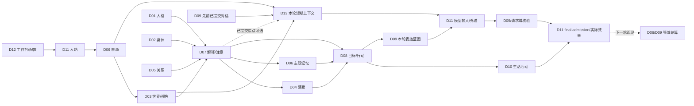

# Sylanne 3.0：十三模块完整设计入口

日期：2026-09-27。状态：**本地完整设计，未实现为完整产品**。原 D01–D12 继续分别拥有各自语义；用户后来要求将短期上下文压缩作为第十三模块并设计相互耦合，因此新增 D13。旧模块任务及工作树保留历史来源，当前以 `G:\Sylanne` 的下列文件为本轮设计入口；不创建设计 PR 或推送。

| 模块 | 主规格 | 协作与验收 | 唯一拥有的语义 |
| --- | --- | --- | --- |
| D01 主体与人格 | [原稿](../modules/01-persona.md)＋[完整补充](../modules/01-persona-completion.md) | [合同](../modules/01-persona-contracts.md) · [验收](../modules/01-persona-acceptance.md) | 身份/价值/特质/自我认知、长期策略、自传 |
| D02 身体与需求 | [主稿](../modules/02-body-needs.md) | [合同](../modules/02-body-contracts.md) · [验收](../modules/02-body-acceptance.md) | 模拟身体/需求及角色劳动资源 |
| D03 世界与情境 | [主稿](../modules/03-world-context.md) | [合同](../modules/03-context-contracts.md) · [验收](../modules/03-context-acceptance.md) | 实体/世界事件身份、社会角色绑定/适用规范、视角、日历语义 |
| D04 情绪与调节 | [原稿](../modules/04-emotion.md)＋[完整补充](../modules/04-emotion-completion.md) | [合同](../modules/04-emotion-contracts.md) · [验收](../modules/04-emotion-acceptance.md) | 连续混合感受、心境、自我感受理解和调节 |
| D05 社会关系 | [主稿](../modules/05-relationships.md) | [合同](../modules/05-relationship-contracts.md) · [验收](../modules/05-relationship-acceptance.md) | 分对象/领域的信任、边界、亲近和修复 |
| D06 记忆系统 | [主稿](../modules/06-memory.md) | [合同](../modules/06-memory-contracts.md) · [验收](../modules/06-memory-acceptance.md) | 来源、主观痕迹、联想、回忆和维护 |
| D07 注意与认知 | [主稿](../modules/07-attention-cognition.md) | [合同](../modules/07-cognition-contracts.md) · [验收](../modules/07-cognition-acceptance.md) | Concern、焦点、工作集、解释和反思 |
| D08 动机与执行 | [主稿](../modules/08-goals-execution.md) | [合同](../modules/08-execution-contracts.md) · [验收](../modules/08-execution-acceptance.md) | 目标、承诺、联合计划、行动意图和领域结果 |
| D09 对话与表达 | [主稿](../modules/09-dialogue-expression.md) | [合同](../modules/09-dialogue-contracts.md) · [验收](../modules/09-dialogue-acceptance.md) | 话题/表达蓝图、语言实现、分段和节奏 |
| D10 生活与主动行为 | [主稿](../modules/10-life-proactivity.md) | [合同](../modules/10-life-contracts.md) · [验收](../modules/10-life-acceptance.md) | 活动/兴趣项目、排程、习惯执行与主动机会 |
| D11 运行内核与宿主 | [主稿](../modules/11-runtime-host.md)＋[数值执行](../modules/11-runtime-numerics.md) | [合同](../modules/11-runtime-contracts.md) · [验收](../modules/11-runtime-acceptance.md) | 共享图/事务/预算/数值执行/宿主与实际派发 |
| D12 工作台与交付 | [主稿](../modules/12-workbench-delivery.md) | [合同](../modules/12-workbench-contracts.md) · [验收](../modules/12-workbench-acceptance.md) | 创作和编辑工作流、产品授权、迁移/交付界面 |
| D13 短期上下文 | [主稿](../modules/13-short-context.md)＋[压缩机制](../plans/alpha1-20260923/astrcontinuum-for-sylanne.md) | [合同](../modules/13-short-context-contracts.md) · [验收](../modules/13-short-context-acceptance.md) | 最近 72 小时对话的可删除压缩表示、异步预制和本轮短期片选择；不拥有记忆或事实 |

跨模块公共语义以 [全系统协作合同](module-collaboration-contracts.md) 和 [十三域耦合总装](sylanne-3-thirteen-module-coupling.md) 为准。旧 [系统总纲](embodiment-3-system.md)、[机制稿](embodiment-3-mechanisms.md)、[生态稿](embodiment-3-ecosystem.md) 是来源及目标账，不替换已明确的 D04 非状态机方向。用户确认方向与可修订工程默认值在各域主稿分别标记；具体角色初始性格、关系对象和生活题材由 D12 配置，设计本身不依赖这些创作选择。

跨系统场景、回滚/权限/未决效果见 [联合验收](sylanne-3-integration-acceptance.md)；旧需求账逐项对应见 [覆盖矩阵](sylanne-3-requirements-coverage.md)。本轮完成十三域耦合设计，并新增 D13 公共类型与无模型原文尾部选择切片；它们尚未接生产投影、异步压缩或模型外送。真实平台、数值实现、产品工作台、分发包和角色行为仍须按这些场景验证。

箭头表示阶段依赖或标出的下一轮反馈，不规定每轮逐个执行所有模块。D09 先前已提交对话可供 D13 选择，本轮表达不能反向证明自己已发生；D13 只向显式需要近期对话的模型调用提供可裁片。D11 只签发运行事实，领域各自决定语义；`received/proposed/adopted/executed/observed` 分别记账。运行必须经合法路径，不能让最终自由语言绕过已经形成的角色状态和行动资格。
