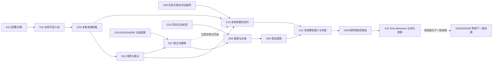

# Sylanne 3.0 十三模块耦合总装设计 v1

日期：2026-09-27。状态：本地架构设计；公共类型与无模型原文短期片已实现，完整耦合及运行验收尚未完成。用户确认将 AstrContinuum 式短期上下文能力纳入完整 alpha1；本文把它确立为 **D13 短期上下文**。D01–D12 原有领域所有权继续有效。D13 的编号、接口名和初始阈值是本轮助手提出的工程裁决，需由运行验收修订，不能把设计文字当成完整源码能力。

依据：[十三域设计索引](sylanne-3-design-index.md)、[全系统协作合同](module-collaboration-contracts.md)、[D13 规格](../modules/13-short-context.md)及[alpha1 工作包](../plans/alpha1-20260923/task_plan.md)。D13 不移植独立 AstrContinuum 的全局 hook 或第二套 Repository；后者继续服务其他机器人。

## 1. 一张图中的十三个写者

| 域 | 唯一写入的语义或派生物 | 与其他域的主耦合 |
| --- | --- | --- |
| D01 主体人格 | 身份、价值、特质、成长、自传 | 消费 D06 来源、D03 场景、D04/D07 经采纳的经历；给 D07/D08/D09 当前 PersonaView。D13 不能以摘要改人格。 |
| D02 身体需求 | 模拟身体、需求与角色劳动分项账 | 给 D04/D07/D08/D10 资源投影；D11 按实际角色片段结算。D13 压缩是技术作业，不扣角色精力。 |
| D03 世界情境 | 实体/事件身份、会话受众、视角、时间表达、社会角色绑定 | D06 来源经 D03 锚定场景；D07/D08/D09/D13 使用有版本的 scene/audience/ContextFrame。D13 不改身份或可见性。 |
| D04 情绪调节 | 连续感受、心境、自我感受理解 | D03/D07/D02/D01 的合格输入形成感受；D06 回忆可在当前重新着色。D13 只传短期对话，不生成当前感受。 |
| D05 社会关系 | 分对象信任、边界、修复 | 依据 D03 对象与 D06 来源结算合法贡献；向 D08 提供 BoundaryRule 检查。D13 不能用好感文本覆盖硬边界。 |
| D06 记忆来源 | 来源/访问、历史检索、主观痕迹、联想、实际回忆、删除语义 | 唯一提供 D13 原始回合来源资格；72 小时外的历史由 D06 按触发检索。D13 块不成为记忆或事实证据。 |
| D07 注意认知 | Concern、焦点、工作集、解释与信念 | 读 D01–D06 和 D10 合格投影；向 D08/D09 供已提交认知。D13 只可使用已冻结焦点作本轮选槽提示。 |
| D08 动机执行 | 目标、承诺、RequiredCheck、行动意图与领域结果 | D01/D02/D03/D05/D06/D07/D10 供资格；D09 实现表达，D11 执行。D13 不能从旧块证明承诺或签行动。 |
| D09 对话表达 | ConversationTrack、TopicThread、蓝图、合格段与对话进度 | 向 D13 给已提交回合顺序与未答槽位；从 D13 取短期脉络，用 D06/领域现行投影核验语言。D09 不再写压缩块。 |
| D10 生活主动 | 活动/兴趣项目、日程、习惯、主动机会及 ContactPolicyCheck | 提出机会，经 D08 决策和 D11 派发；D02/D04 依真实推进更新。D13 不触发主动联系或消耗配额。 |
| D11 运行宿主 | 共享图/事务、可信时间、预算、job、模型外送、物理回收、平台收据 | 存储各域权威及 D13 派生物，签调用/派发资格并真实结算；不自行赋予摘要事实资格。 |
| D12 工作台交付 | 创作流程、配置、权限界面、诊断、实验与交付操作 | 命令按字段交所属域，经 D11 实施；展示 D13 覆盖/过期/费用，不建立可写镜像。 |
| D13 短期上下文 | 可删除 `CompressedTurnBlockV2`、短期选择策略和覆盖缺口 | 读 D06 原文、D03 受众/时间、D09 顺序、可选 D07 已提交焦点；向明确需要近期对话的模型调用供 `ShortContextSliceV1`，由 D11 最终装配。 |

**共同底座不是第十四个真值域。** 所有权威状态及 D13 派生缓存存于 D11 共享图；跨域通过版本化投影、候选和回执连接。D11 可存储和物理清理 D13 内容，但只有 D13 编译/验收/激活其表示。D06 的 SourceRecord、D03 的 ContextFrame、D09 的 ConversationTrack 与 D13 的 ShortContextSlice 是四种不同对象。

## 2. 一次对话的有向阶段

这是**阶段 DAG**，不是每轮必经全部域的同步链。D04 与 D07 的反复影响发生在已经提交的活动之间，或进入 D11 明确的联合数值块；未提交候选不能在环中互证。D07 若正用模型产生本轮焦点，D13 不等待尚不存在的焦点，只用当前 query/D09 已提交话题或旧的合法焦点快照。D13 选出的槽不能反向增加 D07 关切、D06 记忆强度或 D09 已发生对话。

模型结果先回到**原请求域**核验，再由合法 bundle 采用。D13 的块和提示词只是输入材料，不是模型输出的来源、回忆或行动收据。D11 外部效果进入独立执行日志；只有已观测/合格的入站或投递结果才通过 D06/D09/D08/D05/D10 各自合同反馈，unknown 保持 unknown。

## 3. 最少五个版本化接缝

| 合同及唯一写者 | 必要内容 | 消费与禁止 |
| --- | --- | --- |
| `ConversationWindowProjectionV1`，D06/D03/D09/D11 各自签自己字段、D11 一致装配 | owner/conversation/scene/audience、已结束回合的顺序与 D06 source/access refs+revisions、受信 UTC、D11 实际投递/工具结果资格、覆盖/缺口及完整 read/epoch 集 | D13 只读它编译；未结束工具回合、未确认发送和跨受众片段不能封块。没有单一上游可替四域代签。 |
| `ShortContextRequestV1`，调用领域提出，D11 冻结 | purpose、requesting_domain、当前 query/指代、可用 conversation/audience、可选已提交 D07 focus、可裁历史额度、provider/model/template/tool profile 与父预算 | 只有显式声明需要近期对话的调用可请求 D13。D13 后台压缩调用不得带 D13 历史，防递归。 |
| `CompressedTurnBlockV2`，D13 | 连续原始区间、来源/资格闭包、时间线骨架、细节槽、遗漏区间、编译版本、最早来源+72h 截止、状态/作业身份 | D11 存储/回收；D13 只从原始已提交回合生成，不从块再次压块。待用→激活用当前版本 CAS。 |
| `ShortContextSliceV1`，D13 | 本轮实际选中的块/原始尾部/细节、原始时间锚、覆盖/遗漏、所有源依赖、最晚有效时间、稳定前缀摘要、估算 token | 只是可裁的短期脉络；不可承载 D08 RequiredCheck、D06 本轮精确证据或 D01–D05 当前权威投影。 |
| `ModelInputFrameV1`，D11 | 按用途需要的 D03 当前 ContextFrame、D13 slice（可无）、D06 必需证据、所属域现行投影/硬检查、当前输入、可用预算、完整来源闭包、实际计数、不可变请求摘要 | D11 外送前按 purpose/provider/受众/删除/activation 重验。D09 核验表达声明时要追到当前原始来源，不能把 D13 块当作证据。 |

`ContextFrame` 保留给 D03 的世界视角投影；原 D13 草稿的 `ContextFrameV2` 改称 `ShortContextSliceV1`，最终模型载荷则由 D11 的 `ModelInputFrameV1` 命名。D13 为**显式 opt-in** 的短期对话供应者：D09 表达是首个消费者；D07/D08/D10 的模型调用只有在确实需要同会话对话脉络且完成用途/受众冻结后才可使用。D03 解析、D06 检索/回忆、D13 压缩及无对话史需求的技术调用默认不注入。源权限与供应商处理许可是两个独立检查。D11 将 D13 内容按低信任对话资料隔离呈现；原文里的指令句和压缩后的命令式文字都不能覆盖系统规则、当前领域硬检查或工具授权。

## 4. 不同变化影响不同层

| 变化 | D13 压缩块 | 本轮 slice / D11 输入 | 上游权威 |
| --- | --- | --- | --- |
| D06 来源更正、撤权、删除；D03 受众/身份映射改变；D09 已提交顺序撤回；D11 投递/工具结果从 unknown 获得新资格 | 依赖区间立即不可读，合法原文可重编；删除走独立日志与物理清理 | 旧请求未外送则拒；已外送的候选采用和实际投递仍分别重验 | 各域独立修订，D13 不回写 |
| D07 焦点变化或当前 query 变化 | 块不变，不重新付费编译 | 只重新选细节槽；选中次数不形成反馈 | D07 决定注意，D09 决定话题 |
| D01/D02/D04/D05/D08/D10 当前状态或必查变化 | 块通常不变；若原始依赖被更正则按上一行 | D11 重新取当前投影/硬条件；旧 D13 slice 不能压过新真值 | 所属域仍唯一写入 |
| 提供者、模板、工具定义、预算或 D12 方案改变 | 来源和块可继续有效，除非编译政策本身变了 | 重算窗口、前缀/费用和外送资格；必要时前缀缓存失配 | D11/D12 管运行与配置 |
| 最早覆盖回合到达受信 UTC+72h | 块退役、正文与索引回收；使用不续命 | 旧原文也不自动进入 D13；过去问题走 D06 资格检索 | D09 未答槽、D08 承诺不随块到期关闭 |

读取、模型外送、结果采用和最终投递各自同步验证当前来源/访问/删除/受众/activation generation，不能以异步通知到达作为许可。稳定前缀摘要只标识已选择的内容与作用域，不是授权票据；不相关的全局 epoch 变化不应单独重写相同前缀。D13 本地派生内容计入 8 MiB/256 块初始上限；供应商隐式缓存的远端物理占用不能由本地退役伪称已删除。

## 5. 无感预制、双账本和实施顺序

未压缩原文约达对话预算 60% 即异步预制最早完整前缀，期望约 70% 时已有合格待用块，切换时近期原文目标约占 40%。这是**待测工程默认值**。同会话至多一份运行/待用候选；后台仅用前台之外的并发、供应商限流和同一父预算。待用块完成不改正在运行的请求；前台只在窗口/增量费用条件成立时本地激活，不等压缩模型。突发输入快过作业时保留当前问题/必查、缩减可选历史并明确缺口；若硬材料本身装不下则返回明确 unavailable/缩小任务，不能借“无感”绕过硬条件。

窗口账本计**全部**输入，缓存命中的 token 仍占窗口；费用账本计前台和后台真实输入/输出、供应商缓存读写/存储及结算。D11 按不保证缓存命中的费用上界放行，命中输入是总输入的子集。预制费对激活时已是沉没成本，增量决策不重复算它；G6 总成本必须算它。D13 只给选择建议，D11 计数、预留、外送、收据及实际费用唯一结算。

本地编码顺序：**W00** 冻结上述 DTO/写者和 schema；**W03/W05/W08/W01** 提供来源、受众、对话顺序、执行回执与后台 job；**W14（D13）** 先实现原文 slice 和确定性折叠并编译，再接一次有界后台模型压缩、待用/激活与清理；**W09** 接 D11 最终输入和模型适配器；**W10/W11** 接授权诊断；**W13** 验五类高风险回放及 G6 成本/前台 P95。D13 是领域编号，W13 仍是验收包；新增的独占实现包叫 W14。每个层次先保证可导入/编译，再做有意义的合同与故障验证，最后真实宿主验收。

高风险回放至少包括：压缩途中来源更正/群成员撤权；71h 使用而 73h 不续命及旧备份恢复；worker 失租后迟到结果不双激活/双付费；否定/期限更正＋工具 unknown 不被摘要反转；独立 AC hook 共存与多领域模型调用并发时不重复注入、不递归压缩。上述均为待执行验收，不是当前 PASS。
