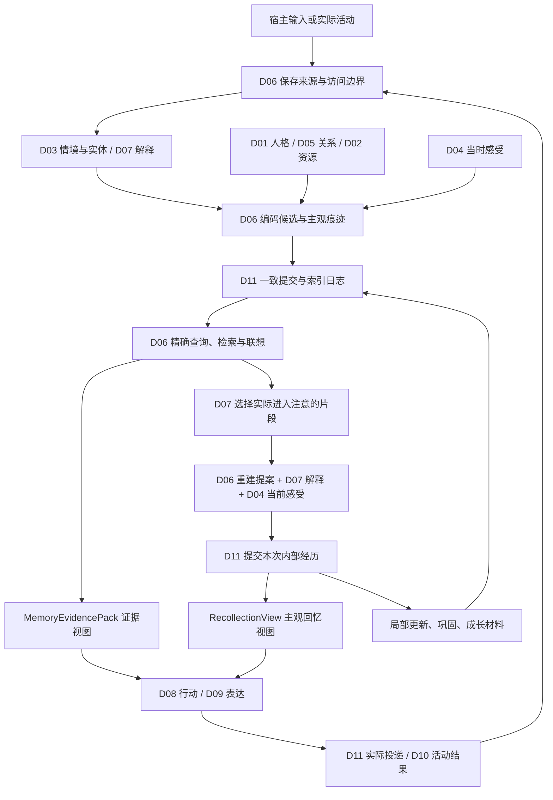

# D06 记忆系统：完整设计稿

日期：2026-09-23。状态：主任务完成的设计选择与公共合同提案，供本地继续审阅；不代表已实施或运行验收，不授权提交、PR、推送、训练或发布。

本文是当前 D06 的主规格。跨模块操作的精确语义见 [协作合同](06-memory-contracts.md)，需求覆盖与后续验证见 [设计验收](06-memory-acceptance.md)。此前的 [存储设计](../architecture/embodiment-3-memory.md)、[回忆控制](../architecture/embodiment-3-memory-theory.md)、[情感机制讨论](../architecture/affective-memory-mechanism-proposal.md)保留为来源；相同问题发生冲突时以本文和协作合同为本轮设计结论。当前源码 API 仍以 `rewrite/MEMORY_CONTRACT.md` 为准，不能把本文接口当成已经可调用。

## 1. 产品目标、已确认方向和本轮选择

记忆参与角色如何理解、感受、建立关系、行动和成长。它既保存发生依据，也形成属于这个角色的主观经历：情感参与记住时的选择与意义，当前心境参与回忆时的重建，同一件往事可以在不同阶段具有不同分量。

用户已确认：人格可以有经历依据地深层成长；人格贯穿情绪过程；复杂感受可并存，内在感受、自我理解和表达可以不同步；情绪不做固定标签状态机；允许独立生活；误会可以暂时影响态度；记忆形成和回忆均受情感加工。来源见 [主任务确认记录](../architecture/design-recovery-20260922.md)。

本轮用户要求把记忆完整设计并考虑模块合作，因此下表明确采用设计默认值，不继续留下未选路线。它们是助手的可修订工程选择，不标作用户逐条确认或科学定律。

| 议题 | 本稿选择 | 理由及限制 |
| --- | --- | --- |
| 权威存储 | 复用 D11 共享图/事务；D06 提供记忆语义与查询 | 避免第二个人格、关系或承诺账本 |
| 主观性 | 来源、主观痕迹、本次重建分别存在 | 允许情感加工和主观误判，也保留纠错依据 |
| 联想 | 稀疏个人关联＋局部情境激活＋D07 注意竞争 | 可以有私人意义、类比和自发回忆，不遍历全图 |
| 回忆后改变 | 采用有条件、可追溯的局部更新 | 实际回忆可影响可提取性；意义修订另需依据，不每次重写全部记忆 |
| 添油加醋范围 | 支持细节突出/遗漏、主观时长感、意义加重、错误归因和重构性推测 | 不自动伪造原话、外部动作或新事件；推测保留来源资格，见 §9 |
| 内部活动 | 允许 D07/D10 调度有来源的回忆、重温、反思与有限反复回想 | 内部活动许可与主动发消息设置分开 |
| 遗忘 | 分别处理可提取性、细节完整度、归档、保留到期和删除 | 不随机删责任，不把难想起等同于已删除 |
| 模型与计算 | 模型提出语义候选；显式算子管理关联、时间、预算、版本与提交 | 不需要先训练新模型；自然语言语义质量仍需评估 |
| 检索 | 关键项精确查＋词法/实体/时间＋个人关联；语义向量可选 | 无向量时保留基础能力并报告质量/覆盖差异 |
| 发布范围 | 完整设计先在本地收敛 | 已有数值/SDK 测试不构成本文验收 |

## 2. 全部模块怎样合作

隔离范围与语义写权限分开：图中的 Bot/persona `Owner` 不是 D01/D06 等模块编号；模块能力表决定谁能写什么类型。每个语义块只有一个合法写者。

| 模块 | 向 D06 提供 | 从 D06 获得 | 不转交的权威 |
| --- | --- | --- | --- |
| D01 主体与人格 | 人格版本、价值/习得策略语义、自传章节候选 | 成长证据、反例、经历/回忆区分、人格相关片段 | 人格修订、策略采用、自传的解释语义 |
| D02 身体与需求 | 精力/疲劳等版本、认知活动成本报价及预留/结算回执 | 实际内部活动起止、已消费资源关联 | 身体状态及资源余额；真实 CPU/token 归 D11 |
| D03 世界与情境 | 实体身份、世界事件身份、场景、时间/视角/现实性解析 | 有来源的历史观察、事件组织、时间视图 | 实体合并与世界事件身份；不以昵称合并 |
| D04 情绪与调节 | 当时/当前感受快照、意义评价、情绪显著性、调节结果 | 主观痕迹、回忆评价输入、实际回忆与来源修订通知 | 当前情绪、心境、自我感受理解及调节效果 |
| D05 社会关系 | 对象/领域关系版本、明确边界、关系贡献规则 | 共同史、支持/反例、新外部事件与内部重温的区分 | 信任、亲近、边界及修复状态，不存第二个好感分 |
| D07 注意与认知 | 关切、竞争解释/信念、注意选择票据、反思问题 | 候选、证据缺口、联想路径、重建提案、待续问题 | 注意工作集、解释选择、信念及 Concern 生命周期 |
| D08 动机与执行 | 目标/承诺/行动的版本化查询视图、真实结果 | 决策证据、精确责任核查结果、修订影响 | 承诺、行动选择、履行/改约/撤销；记忆不关闭责任 |
| D09 对话与表达 | 回答所需槽位、表达目的、允许受众 | 事实可用项＋获准的主观回忆/自述视图 | 语言实现；生成的台词不能回写为过去事实 |
| D10 生活与主动行为 | 实际活动或明确模拟活动的事件、生活时间、反思机会 | 活动相关回忆、分享/创意候选、待续的内部活动 | 日程与生活执行；计划不等于已做过 |
| D11 运行内核与宿主 | 事务、类型/写权限、调度、真实费用、投递、时间与恢复 | 读写集、依赖、幂等身份、可恢复任务、索引 outbox | 原子性、外部副作用与运行保障，不决定记忆语义 |
| D12 角色工作台与交付 | 经授权的查看/纠正/删除/导入命令、方案版本 | 记忆时间线、主观/事实差异、原因路径、覆盖与清理回执 | 产品操作授权与界面；不能绕过领域提交直接改数据库 |

**三处所有权裁决：** D03 的世界事件身份回答“哪件事”，D06 的 `MemoryEpisode` 回答“如何把来源组织为可回忆的经历”，两者不互相取代。解释按语义域写入：D03 管身份/场景组织，D07 管事实信念和竞争归因，D04 管感受自我理解，D01 管人格/自传；D06 只保存其有版本的检索投影，不裁决所有信念。D01 拥有策略与自传语义，D06 可以提出摘要/章节材料，不能自行使策略或成长生效。

## 3. 总体闭环与两种读取结果



这表示依赖及后续事件，不是每条消息都执行一整圈。证据查询可以不产生主观回忆；已有工作集的一个片段也能触发回忆，无须重新搜索数据库。

`MemoryEvidencePack` 提供来源、事实资格、时间、覆盖、冲突与版本，供求证/执行使用。`RecollectionView` 提供这次浮现的片段、意义、自我理解、感受引用和表达资格，供人物体验使用。二者共享出处，但不能互相冒充：主观鲜明不能证明外部事件，保留原文也不让角色随时全知。

## 4. 数据对象、身份与四种关系

| 对象 | 内容与更新原则 |
| --- | --- |
| SourceRecord / SourceAccess | 输入原文、工具结果、设定或内部过程及各自资格；普通修订不覆盖原文；访问可撤销，显式删除可物理清理 |
| EvidenceSpan | 来源中的可引用片段、否定/引用范围、传播家族；不是第二份独立观察 |
| MemoryEpisode | 源引用、D03 世界事件引用、参与者、活动与事件时间；分段/合并保留来源映射 |
| SubjectiveTrace | 编码情境引用、细节的可提取性/完整度、当时感受、多个主观意义引用、当前解释投影版本 |
| Association | 端点、种类、方向、强度、适用情境、形成依据、现实性及权限；可循环，不冒充因果 |
| RecallActivity / Recollection | 触发身份、注意票据、输入版本、浮现片段、当前体验/解释引用、实际提交时间 |
| TraceRevision / Contribution | 局部变化、变化根据、独立来源家族、活动与贡献身份、替代关系；支持去重与重算 |
| SummaryView / DomainView | 来源覆盖、遗漏、冲突、版本、用途；关系/承诺/自传/策略为所属域的只读投影 |
| IndexGeneration / MaintenanceJob | 投影模型/结构版本、水位、覆盖、恢复游标、费用与停止原因 |

稳定身份不由摘要文本或向量相似度生成。模型改写一句话、重试、分段变化不会产生新的独立事件。来源家族由采集/传播依据确定，关系未知就保持未知；不同消息 ID 不是独立性证明。

分别维护：①当前可失效结果的依赖 DAG；②历史经历的来源/沿革引用；③可循环的联想邻接；④D04/D11 的数值耦合。历史引用必须参加删除遍历，但不等于一条当前失效依赖；联想循环不得塞进 `GraphWrite.dependencies`。

四类时间分别存储：事件发生时间、角色获知时间、系统提交序列/时间、内部活动实际区间。生活模拟时间带映射版本；求解迭代次数不算生活时长。未知时间可为空，不能用接收时间悄悄补全。查询显式选择 `as_known_at` 和 `valid_at`，当前权限始终生效。

## 5. 形成记忆：快保存与有情感的编码

接收事件后先持久化来源、访问资格和待处理记录；网络模型不在数据库事务中。结构化承诺或明确更正可直接进入相应域的确定性处理，普通闲聊不强制调用模型。由 D03 解析身份/事件和 D07 组织解释，D06 生成事件组织及编码候选。

编码关注“她当时注意到什么、在意什么”：读取版本化人格、关系、关切和已提交感受。可以突出一句话、弱化背景细节、形成带不确定性的主观意义。片段可提取性、主观确信、情感鲜明度、来源可信资格各自保存，禁止共用一个重要性分数。

情绪评价可能晚于来源入库：先存在 `source_saved/encoding_pending` 的软件处理记录，不假称情感痕迹已形成；以后按原时点可知信息补编码，标明延迟完成。后来的知识不能伪装为当时已知。涉及一次真实内部感受的最终痕迹、经历引用与领域状态采用协作合同 C04 的一致提交。

事件组织使用活动、对象、目标、场景和明确转换；时距仅辅助。一个项目可跨多次对话，一次聊天也可涉及多件事。实体不明时保留候选引用，查询要求消歧；D06 不擅自把两位同名用户合并。

## 6. 按需读取与证据完整性

读取请求带用途、角色、当前受众、模型处理许可、对象/关切、时间视角、待回答槽位和预算。允许用途与用户受众不是一回事：能内部处理不意味着能送给任何供应商或在群聊表达。

首先取相关域的精确视图：D08 承诺/执行、D05 明确边界、D03 身份/视角、D06 撤销/来源资格。必须核查的项由行动类型及领域检查器声明，不能让 D06 根据相似度或心情猜“已经查够了”。检查器不能用时返回未完成，不发依赖这些资格的行动。

一般候选由工作集引用、实体/时间/词法、个人关联及可选语义向量共同产生。候选回源验证后，再按问题补查冲突和反证；来源家族去重同时保留同源不同细节的覆盖。不存在一条“总相似度”可以直接代表事实可信性。

证据包逐槽位返回 `supported/contested/unknown`、当前可用来源、历史/当前解释、缺口和范围覆盖。覆盖至少包括角色/对象/时间/类型/索引水位/候选截断；“完整”仅针对声明的有限查询域，不宣称查遍一切语义可能。负结果绑定查询域代际，新记录或新反证进入后失效。

对普通消费者，缺失、撤权或删除统一为不能据此断言的 `unavailable`，不泄露受限记录是否存在；获准诊断视图可细分原因。索引滞后、预算截断则返回 `partial`。未找到不允许翻译为“你从没说过”。关键项太多时分页或阻塞依赖，不静默丢掉责任。

### 6.1 与旧 `RecallRequest` 状态机的迁移边界（MEM-04）

`rewrite/sylanne3/recall_policy.py` 的 `RecallRequest` 及其状态机是当前源码的真实兼容入口，不能因本稿改名而被悄悄丢弃。完整设计不再把它扩展成第二套持久认知状态：D07 的 `Concern`、`SelectionTicket` 和工作集拥有注意语义，D11 的 durable job/attempt/receipt 拥有可恢复执行语义。迁移适配器必须保留下列状态和字段的可观察含义；在 D07/D11 提供方缺失时，旧入口只能按现有能力返回，不能假称已获得新合同保证。

| 旧状态/字段 | 完整设计中的承接位置 | 迁移规则与理由 |
| --- | --- | --- |
| `CueDetected`、触发原因 | D07 `register_concern` 的触发/角色可见理由，或 C03 的一次性查询 `causation_id` | 原触发不可丢失；不必每次都创建长期 Concern。 |
| `ObligationsChecked`、责任 | D08 `RequiredCheck` 与 C03 `obligation_receipts` | 责任由领域检查器裁决，不能留在 D06 的字符串状态机里。 |
| `WorkingSetChecked` | D07 C03 `assemble_working_set`、`focus_epoch` 与其受众隔离的工作集 | 旧调用方传入的 `working_ids` 只映射为候选输入，不能冒充已持久/已选中注意。 |
| `SearchNeeded` / `EvidenceChecked` | D06 C03 `retrieve_or_associate`、`MemoryEvidencePack` 的 `coverage/slot_results/contradictions` | 保留先检索后回源核查的顺序；精确责任读取仍在候选预算外。 |
| `Ready / Clarify / Insufficient / Deferred` | C03 的 `complete`（带完成槽位）、`partial`＋澄清、`unavailable/partial`＋缺口、`deferred` 及 `stop_reason` | `complete` 只表示声明的槽位完成；旧 `INSUFFICIENT` 不会变成“无此记忆”。 |
| 槽位、时间视角、受众/权限、版本 | `question_scope`/`slot_results`，`as_known_at`/`valid_at`，共用信封的 `purpose/audience/provider_policy/access_epoch`，以及 `read_versions/query_scope_epoch/deletion_epoch` | 这些字段迁入版本化合同，不能只保存一段旧请求 JSON。 |
| 截止、预算、去重键、停止条件 | `deadline`、共享 `budget_lease`、`activity_id/attempt_id/operation_id`、durable job 的 `continuation/stop_reason/no_progress_count` | D11 承担重启、真实费用和幂等；旧 `request_id` 作为 `causation_id`/兼容关联键保留。 |

因此 MEM-04 的“完整字段保存”由上述版本化映射满足，而非承诺继续持久化旧 dataclass 的原字段布局。此替换是后续用户已确认的 D07 单一注意工作集和 D11 单一可恢复作业裁决；旧 API 的适配、schema 版本和迁移回滚仍是实施前置，见合同 J 与验收 T36。

### 6.2 回忆触发门槛与普通问候边界（MEM-05）

触发先产生一次性 C03 查询理由或交给 D07 登记 Concern；它不表示已进入注意、更不表示已经回忆。以下类型是**强制检索触发**：①明确询问过去信息、②指代所需的历史对象或共同经历尚无法消歧、③更正、矛盾或反证、④承诺/履行/改约/撤销、⑤修复、道歉或归责所需的事实依据、⑥期限、日程或活动状态。D07 可决定注意中的可选探索次序，却不能撤销前述触发；D08/D11 仍决定哪些项属于行动前必查及最终准入。

单独的“你好”“早”“晚”“在吗”等普通问候，在没有历史指代、显式过去问题、纠错/承诺/修复语义、期限/活动状态或 D07 已登记且仍适用的 Concern 时，默认不搜索历史。它可以读取当前会话的最小必要上下文，或由 D07 选择已经获准的工作集片段；两者都不是数据库历史检索。问候附带“上次那个项目怎样了”“还记得你答应的事吗”或可解析的既有事项时，按对应强制类型处理，不能借“问候”标签跳过。该边界是默认路由规则；D12 可配置角色的主动性，但不能把普通问候改成无界后台翻查，也不能降低强制触发或 D08 必查。

## 7. 联想与注意：从轻微唤起到实际想起

关联可以来自共同经历、相似细节、主观意义、期待、对比和类比。已有稀疏联系走本地索引；新语义类比由模型提出两端引用与理由，先留在本次工作集，不直接永久加边。一次重要经历即可形成有意义的联系，不要求靠重复次数堆出强度。

D06 在获准子图上作有界激活传播，D07 决定哪个片段实际进入注意。采用连续的关联权重与情境适用度，不以情绪标签切换固定路径。初始工程算子如下：

```text
a_next = clip((1 - leak) * a + cue + spread * P(context)^T * a - inhibition, 0, 1)
0 < leak <= 1; 0 <= spread < leak
P 的非负出边权重归一化到行和 <= 1
```

所有输入/参数须有限，`a,cue,inhibition >= 0`。该形式在 cue=0 时对 L1 总量给出系数不超过 `1-leak+spread<1` 的界限，仍需测试实际实现、裁剪和抑制行为；不是人类心理方程。环可存在，访问和贡献去重、最大迭代/节点/时间预算同时限制运行。关联强度不随一次求解的迭代次数增加。参数和坐标按策略版本保存，可重放；不允许模型即兴改求解参数。

情境包含对象、当前关切、人格/关系与感受的版本化特征。检索嵌入只用于候选相似，不能替代这些有语义的结构。一个片段选中后，可将其过去情境有界混入回忆工作集，引导后续路径；是否改变当前情绪由 D04 在真实活动提交中决定。

D07 综合当前相关性、个人意义、新颖/冲突、未解关切、当前投入和中断代价，选择有限但可含多个片段的工作集。当前思考有持续性，避免微小优先级抖动不断换主题。被命中但未选中的候选不算经历、不扣角色体验成本、不强化长期记忆；实际计算费用仍由 D11 记账。

## 8. 主动回忆、重温、回避与反复回想

以下是同一调度机制中的目的和倾向，不是固定人物情绪状态或必经心理阶段。

| 情况 | 启动与继续依据 | 结束/暂停及跨模块影响 |
| --- | --- | --- |
| 主动求证 | D07/D08 明确问题与证据缺口 | 足够支持该任务、无可用入口或预算用尽；必查未完成不执行相关行动 |
| 自发想起 | 当前话语/活动/关联带来个人线索，D07 选择进入注意 | 可只浮现一瞬，不必表达或搜索完整历史 |
| 刻意重温 | D01 偏好、D04 调节/分享动机、D10 活动机会 | 可以以个人意义而非新知识为目的；仍有真实时长与费用 |
| 反思 | 某个冲突、疑问、实际结果或成长问题 | 提出解释/策略候选；没有新依据可留下未知，不强求领悟 |
| 回避 | D04/D01 提供不愿触及的倾向，D07 选择推迟可选探索 | 保留关切与后续线索；不能跳过承诺/权限/纠错的执行前核查 |
| 反复回想 | 未解关切与新触发，或获准的延续活动 | 可再次难过或安慰，但不能重复结算外部伤害；到预算边界保存待续问题 |

去重使用真实因果活动 ID 和阶段贡献键；“来源家族＋时间窗口”仅作冷却/准入特征，不吞掉同窗口内两次独立、实际发生的内部活动。数据库重试、缓存读取与数值精修沿用同一活动 ID。

没有新触发或到期条件时不循环扫描往事。内部活动是否运行由单独设置与 D02/D11 资源共同决定；安静时段默认限制对外主动消息，不禁止内部整理。宿主停机时不补造思想活动；恢复后可以安排一次现在的回忆，也可执行获准的、明确标注模拟时间的 D10 活动，不能倒填成实际停机期间的对话/经历。

## 9. 重建：情感怎样添油加醋

重建读取选中的细节、当时意义、允许访问的后续信息及当前人格/关系/心境。输出结构化的突出片段、模糊/未提取部分、当前解释候选、主观时长/分量、自我理解候选与给 D04 的评价输入。D07 选择事实归因，D04 决定当前感受，D06 将它们组织为本次回忆；D09 最后实现语言。

允许一段等待在她心里变得很漫长，允许“我觉得那次不被重视”的错误归因，允许后来觉得当年的失落青涩。系统保存这些作为角色的主观版本，而不是把主观性自动纠正成中性日志。

细节状态选择 `retrieved / blurred / inferred / unavailable`；解释可以有自己的确信，但 `inferred` 不因反复重温升级为已观察。默认不由模型补造具体原话或外部动作；想象的画面可以存在于反事实/想象分支，后续提取仍保留这一资格。直接引用必须能对齐允许表达的来源；“你答应过”的责任断言须查 D08，不能仅凭回忆中的确信成立。

回忆文字不是事实权威。D09 获得获准的自述与事实字段：可以表达委屈、模糊印象或不准确的感受自我理解，但不得把模型补全当作核实过的外部事实。更正也不要求她立刻释怀；纠正的是当前归因资格，感受按 D04 继续演化。

内部可处理但不可公开的来源，只能通过经声明和审查的输出投影影响表达；不能把受限原文交给面向群聊的模型再要求它保密。私人依据的摘要/类比默认继承限制，未经明确定义的转换不自动“脱敏”。

## 10. 回忆后更新、巩固和成长

本稿采用“实际回忆留下内部经历，但不必每次永久改写旧解释”。一次有效提交可以更新细节可提取性或关联熟悉度；解释/意义变化则要有新信息、真实重评或当前体验的明确记录。变化是局部的，保留旧版本，原事件次数不变。

贡献键为 `(owner, causal_activity_id, target, contribution_kind)`；修订替换同一贡献链，不再次新增贡献。关系/成长消费额外跟踪外部来源家族：十次内部重温是十次内部体验，却仍只支持原来一次外部失约。D01/D05 自行决定哪些内部体验可影响自我策略，不把它们当十份独立对方行为证据。

巩固读取冻结快照，按脏对象增量处理：整理事件、摘要覆盖、提取稳定命题材料、关系共同史、策略经验、自传章节材料。D07 接受/修订事实解释；D01 接受人格/策略/自传；D05 接受关系贡献。D06 不因生成一个连贯故事就自动改变这些域。

摘要保存覆盖清单、遗漏/冲突、来源根和时间视角。摘要的摘要不形成独立证据，也不使受限来源公开。巩固不能替代未完成承诺的精确记录。模型输出非法、来源更新或预算耗尽时保留待处理任务，不发布半成品为当前解释。

## 11. 遗忘、干扰与容量

普通遗忘首先表现为细节不易提取，而非原始记录凭空消失。作为可校准的初始算子，对每个细节维护可提取性 r、稳定时间尺度 S、上次实际更新时点；无新活动时用 `r(t)=r0*exp(-Δt/S)` 惰性计算，S 有配置上下界。同一事件的不同细节可有不同 S，不能只存事件总分。

实际回忆可按 `r_new=r+eta*(1-r)` 有界增强，全部量须有限，`r,r0,eta∈[0,1]、S>0、Δt>=0`；S 的配置上下界也须有限且大于零。eta 由策略与真实活动质量控制；错误推测的反复熟悉不提升证据资格。此公式只是一阶可提取性模型，不声称覆盖全部情感记忆；情感意义及联想另行计算。若校准后需替换算子，保持字段语义、版本与回放比较，不以临时改阈值掩盖失败。

相近经历竞争候选预算，保留相似但不同的事件 ID 和区分线索；不能为了模拟干扰而把两次经历硬合并。细节压缩必须记录丢失范围，正文依赖只剩摘要时明确无法精确引用。温暖或痛苦的意义可以在细节变模糊后仍有来源化概括，不假造仍然准确记得每句话。

归档改变存储/索引层级，工作集淘汰只丢引用缓存。承诺、明确边界、正在纠错/删除的材料和有效长期状态所必需的来源具有保留保护。存储配额到达后先回收可重建索引、可丢缓存，暂停低优先级导入/维护并报告容量；不能静默丢新消息后声称已记住，也不能无上限承诺保存。保留期到期导致内容清除时，走 §13 的删除/失效流程，不称为普通遗忘。

## 12. 纠错、身份修正与时间

新陈述先保存为来源，再区分原先说错、后来变化、第三人说法、身份纠正或尚未解决的冲突。D03 处理实体/世界事件归属，D07 处理命题适用性与解释；D06 定位来源和受影响的痕迹/关联/投影。

确认旧解释无效后立即停止其当前读出和责任驱动，沿依赖使摘要、关系贡献、人格依据、工作集和未执行计划失效。即使后台重建没完成，也不能继续用已知错误的旧版本；可查询合法来源或返回未完成。D04 保留当时确实发生的感受并修订当前驱动；D05/D01 重算对应贡献；D08 重新核验计划与待发送动作。

已发送内容和实际结果不会因解释被撤销而假装没发生；若需要澄清/道歉，由 D08/D09 形成新行动。非线性派生状态按有效检查点和剩余依据重建，不能统一减去一个历史分数。

历史读取在事件时间与获知时间上分别筛选，并通过 D11 的版本历史能力重建当时可知内容；当前实现不具备完整历史解释查询，此项是新增能力。周五得知周一的事，不能在“周三她知道什么”的视图里出现。更正不是时间倒流。

## 13. 隐私、删除与恢复

来源、解释、个人关联的形成理由、向量、摘要和任务临时内容都继承必要权限。内部可见端点之间的私人关联本身也可能受限；遍历要检查边和路径依据。发送前重新检查当前访问代际，不能只验证召回时权限。

删除使用专门的 D11 特权清理接口：来源的普通不可变规则不阻止用户删除。按协作合同 G，先耐久保存独立的写前删除意图与单调恢复水位，再在权威命名空间原子撤权、提升删除/权限代际、取消或使在途候选过期；两者确认前不返回已接受。之后清理受控原文、图历史值、事件日志/幂等参数副本、解释/痕迹、联想理由、索引、缓存、维护任务及受控导出。

D01/D04/D05/D07/D08 对受影响的当前状态按合同重建或净化，并报告完成；不能只删除链接而保留可恢复原内容的长篇主观叙述。不可精确分离的混合状态采用明确的局部重置并记录连续性损失，未净化的相关读出不服务。历史删除后可能无法完全回放，不伪称精确恢复。

回执分别列逻辑不可读、受控内容清理、SQLite WAL/空闲页清理、备份处置、外部副本限制。普通删除不宣称 SSD 介质级安全擦除。受控备份要重写或销毁；未清理备份不得标“所有副本已删”。用户或供应商持有的非受控副本只报告范围，不声称能够远程擦除。

恢复备份需先加载独立保存的非内容删除清单/权限代际，并证明其覆盖最新耐久删除恢复水位；格式完整但新旧不明不足以开放。清单/水位丢失或被回滚时隔离恢复，禁止对外读取旧内容。幂等去重记录仅保留非内容身份/不可逆校验，不允许为重试保存删除后的完整请求体。

## 14. 索引、预算与非阻塞执行

权威写入与索引 outbox 同事务，后台按对象/版本幂等消费，记录水位。索引结果只是候选，回源校验当前权限/解释/删除代际。新增记录尚未入索引时，在有限增量日志补查或明确 `partial`，不能只过滤旧结果就宣称完整。

使用共享 SQLite；实体/时间/关键项索引必需，全文能力启动时探测，无全文扩展时采用有界基础查询并显示覆盖差异。向量投影可选，记录模型、维度、预处理、对象版本与权限分区；换模型新建代际，不混算空间。默认安装不捆绑大模型或要求外部数据库。

一个父任务共享前台/后台真实预算，模型提取、嵌入、重排、重建与 D04 评价均计入；不能在各模块各开一份隐形配额。检索不需要生成模型不代表新颖回忆重建也免费。初始运行配置如下，属于设计开发上限而非测得性能：

| 路径 | 初始局部上限 | 结束语义 |
| --- | --- | --- |
| 精确责任/来源查询 | 分页、每页不超过 64 项；父任务记录总节点/截止时间 | 未核查完整就不签发相应行动资格，不能无限扫描 |
| 当前工作集读取 | 0 次辅助生成；仅复核已获准的 D07 工作集引用及其来源/权限/版本 | “0 次”不等于零数据库读取或零 CPU；若复核失败返回缺口，不能借此触发模型生成 |
| 一般候选/联想 | 每个候选通道最多 32 个初始候选；按稳定对象/来源家族去重、融合并排序后最多 64；传播最多 128 节点、2 跳，另受迭代/时限限制 | 通道包括工作集外的实体/时间/词法、个人关联和可选语义向量；精确责任读取不受这组候选上限截断。明示裁剪与可续前沿，非人物能力上限 |
| 新颖语义编码或回忆重建 | 每前台父任务最多 2 次辅助生成尝试，由 D07 分配给 D06/D04 等 | 格式失败/超时也扣费；不足时保留待处理，不伪造体验 |
| 回忆工作集 | 按条目与 token 双限；初始回忆内容预算 2048 token | 先压缩引用与冗余；事实缺口不被摘要掩盖 |
| 后台巩固/深探索 | 默认每任务最多 2 次辅助生成，另受每日额度和公平队列控制 | 可暂停续接；显式复杂任务可经运行策略配置增加预算 |

实际 deadline、CPU、内存、上下文和每日费用来自 D11 的必填 `ResourcePolicy`，无额度不自行生成无限预算。D02 的角色精力预算是另一维；实际消耗与剩余预留都需正确结算，不把模型 token 当作人物情感强度。

继续检索以已接受回合的结构化缺口差值计数：必需槽位、必查回执、时间/主体限定、反例/纠错和责任覆盖任一项减少才算进展。对仍有**可选**前沿的继续，D06 计算有界的 `continuation_value = w_e*evidence_gain - w_l*latency_cost - w_c*call_cost - w_i*context_interference`：`evidence_gain` 只能来自预计可减少的声明缺口、反证覆盖或可核验来源家族增量；四项都归一到有限 `[0,1]`，四个权重非负且和为 1，阈值也在 `[0,1]`。`latency_cost`、`call_cost` 读取 D11 的预留/实际报价（未知费用不得按零），`context_interference` 由 D07 依据焦点、工作集容量、切换与中断票据报价；D06 不能自行猜人物成本。只有预算、截止、权限、候选入口均合格且该版本化策略的净值严格超过阈值，才可继续该可选前沿。权重、归一化方法、阈值、适用查询类型和版本边界属于 `ContinuationPolicy`，由 D12 编译进 D11 manifest；未知版本、越域值或缺少报价返回 `deferred/unavailable`，不使用默认模型臆测补齐。

这项收益判定只决定可选扩展的先后或何时停止，**不得跳过、删除或宣称完成** D08 声明的必查、D06 的强制触发精确核查、D11 权限/删除屏障或最终 admission；这些项不能用负净值换取行动资格。继续不合算时，D06 返回已得证据及未满足的必查/槽位，而非把它们压缩掉。连续两轮合格、可比较的搜索/证据回合都没有减少缺口时，D06 将 `no_progress_count=2` 与前沿、已查来源家族、四项估值/政策版本和原因交给 D07/D11，停止继续扩展；重传、`stale`、取消或同一 operation 的重复收据不计一轮。没有合法入口、权限阻断、截止或预算耗尽也立即停止并保留相应原因。新来源/反证、权限恢复、问题/时间域改变或可续前沿带来可验证的新入口时才重开并从零计数。必查项尚缺时停止结果只能是 `partial/deferred/unavailable`，D08 不得据此行动。这是 MEM-07 的“两轮无缺口减少”规则；D07 的反思作业也复用它，不以换一段措辞或拆子任务绕过。

同步数据库/图计算在有界工作线程运行，远程模型异步；纯算子无网络副作用。暂停任务保存读集、阶段、前沿、费用、取消状态及原幂等身份；恢复先重验输入。模型不可用可以继续证据读取，但不能声称完成了尚未执行的主观重建。

## 15. 故障、并发与实际运行边界

同一角色跨私聊/群聊延续合法状态，不同角色/Bot 不共享私有痕迹；跨角色授权知识只建立受限引用，不合并人格历史。每次请求冻结输入版本、权限代际和查询域水位，提交时检查完整读集和缺失键版本。

| 情况 | 处理 |
| --- | --- |
| 重复宿主事件/模型重试/重启 | 同一尝试的 operation_id 重放原收据；过期重装配用新 attempt，保留活动/effect/贡献身份与父预算，已完成活动不再次提交 |
| D07 选择后来源被修订/撤权 | 票据过期，撤销未提交重建；新任务重装配，费用不回零 |
| 数值/模型失败或 D04 不可用 | 来源保存仍有效，体验标未完成；不提交假中性情绪 |
| 两会话同时回忆同一来源 | 不同实际活动可各自存在；当前状态冲突按版本重装配，不重复共享贡献 |
| 提交后通知丢失 | 通过持久化 outbox 重放；接收者按 effect_id 去重 |
| 资源已花费但体验提交失败 | D11 真实费用保留；D02 按已确认活动量结算/释放余额，不记不存在的成功体验 |
| 发送结果未知 | 记为未知投递，不推断对方已读、拒绝或沉默，不自动重发 |
| 权威存储损坏 | 隔离受影响域并恢复/报告缺失，不用模型补历史 |

具体提交顺序、状态及返回类型见协作合同。表中的软件任务状态不代表人物的情绪状态机。

## 16. 导入、导出和角色工作台

旧数据只允许显式离线导入：D12 先选择范围和预览映射，D06 校验来源/身份/现实性，写入新类型并保存导入批次与旧标识映射。无法识别来源、身份或时间的内容保留未知/隔离，旧好感值不冒充新关系真值，作者背景不冒充实际相处。导入可重复而不重复成长；失败批次不半开放。旧运行核心不作为回退。

导出只包含当前授权且允许导出的对象、必要来源和版本清单；秘密配置/供应商凭据不在其中。导入导出的明确文件去向由用户选择；备份和分享导出分别标记可控范围。复制角色默认复制创作设定，不带入原角色私人经历；显式获准迁移经历需新隔离映射并保留来源资格。

D12 提供：经历时间线（发生/获知）、同一记忆当时与现在的视图、共同史、联想路径与排除原因、主观鲜明度与事实资格的区别、纠错影响预览、遗忘/保留设置、删除范围及回执、导入预览和隔离实验。诊断只显示实际输入/算子/版本及可见解释，不编造模型隐藏推理。

隔离实验可比较同一记忆在不同心境的表现，但使用独立命名空间和模拟资格，不写回真实关系、人格或回忆消费。工作台操作走公开合同，不直接修改图值。

## 17. 实施依赖与完成标准

设计责任在本稿内闭合；其他模块尚未实现的协作接口由本稿定义为实现前置条件，不能为了先跑起来复制旁路状态。具体落地顺序及源码差距见 [验收文档](06-memory-acceptance.md)。

完整运行完成需要来源/时间/权限基础、跨域一致提交、检索/索引、情感编码与重建、联想注意、更新巩固、删除恢复、宿主与工作台共同贯通。第一批切片可以逐项交付，但不能用其中任一切片宣称整个记忆模块完成。性能数字、语义质量、人物体验和平台行为分别验收。

## 18. 研究使用范围

本设计借鉴 CMR/eCMR 的情境关联与检索组织，参考记忆重评实验来提出可检验的回忆更新假设。已核读来源、限制与链接保留在 [机制提案的研究部分](../architecture/affective-memory-mechanism-proposal.md)。旧工程研究参考保留在 [回忆控制稿](../architecture/embodiment-3-memory-theory.md)。

本稿的激活算子、可提取性衰减、去重身份、跨模块合同和费用配置是工程选择，不是这些论文已经验证的完整人物模型。没有在本轮重新复现论文、训练模型或运行性能实验。
