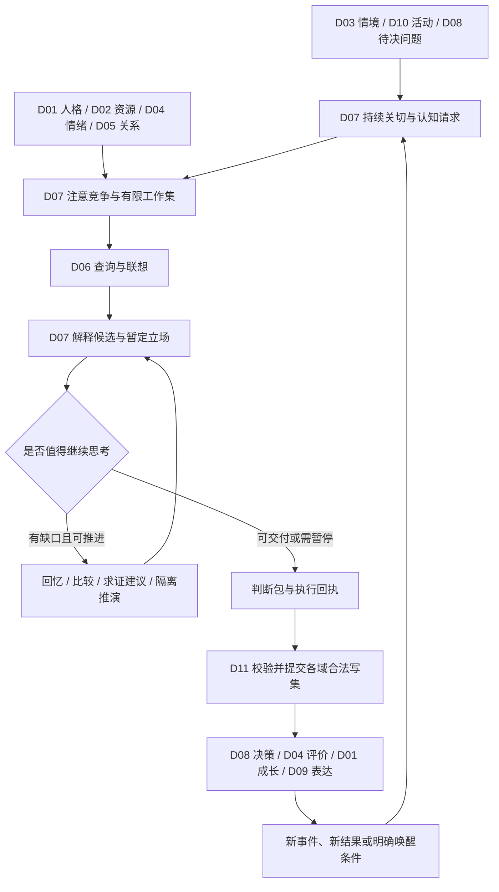

# D07 注意与认知：完整设计稿

日期：2026-09-23。状态：本轮完整设计选择与公共合同提案，尚未实现或通过运行验收。主任务继续本地设计；不授权提交、推送、PR 或上线。精确操作见 [协作合同](07-cognition-contracts.md)，需求与验证见 [设计验收](07-cognition-acceptance.md)。

## 1. 目标、已有约束与本轮选择

D07 让角色有持续在意的事、有限而有倾向的注意、可并存的解释，以及重新审视自身判断的能力。她会形成第一印象、走神、犹豫、好奇、误会和改观；这些表现要能追到自己的情境、人格、感受与经历，而不是逐轮凭台词编出来。

用户已确认的人格成长、情绪与自我理解不同步、情感加工记忆，以及本轮要求的完整设计/模块协作，构成约束。此前“是否总能察觉自己想偏了”没有得到直接回答。本稿选择：具备有限自我察觉能力，但察觉可能迟到、出错或未发生；能力的表达受 D01 策略、D02 资源、D04 当前感受与实际经历影响。这是可修订工程默认值，不标为用户逐项确认。

| 路线 | 收益 | 代价及本轮裁决 |
| --- | --- | --- |
| 每轮全面审慎推理 | 解释比较显式 | 成本高，易把角色做成持续自我审核；不采用为默认 |
| 直觉直接决定一切 | 第一反应鲜明 | 易混淆印象与证据、缺乏纠错过程；不单独采用 |
| 直觉先形成，反思按需介入 | 有个性反应，也能重新理解 | 需明确触发、预算与状态；本轮采用 |

“直觉”和“反思”是不同计算路径，不是两个永久人格、两个常驻 Agent 或固定心理阶段。工程上复用模型的语义能力，辅以显式证据结构、调度与版本化更新，不要求训练新权重，不声称实现人类意识或特定心理学理论。

## 2. 与全部模块的分工

所有权指共享图中某类语义的合法写者；`Owner` 仍是 Bot/角色/对象隔离键，不把 D07 增加为图的 Owner kind。

| 对端 | 输入 D07 | D07 输出 | 权威边界 |
| --- | --- | --- | --- |
| D01 主体与人格 | 价值、偏好、自我判断、习得思考策略与可塑性版本 | 价值冲突问题、策略试用建议、成长支持/反例材料 | 人格、策略采用、自传解释由 D01 写 |
| D02 身体与需求 | 精力/疲劳/需求视图、活动报价与预留 | 注意劳动请求、实际支出回执引用、休息建议 | 身体数值与余额由 D02 写，宿主计算预算由 D11 写 |
| D03 世界与情境 | 场景、实体/事件身份、现实性、可见信息及时间 | 歧义问题、归因候选、视角推断的依据缺口 | D03 管身份/情境；D07 管关于世界与他者的可修订解释 |
| D04 情绪与调节 | 显著性偏置、当前感受、自我理解的角色可见投影、调节请求 | 采用的解释、注意转移/反思执行结果、待评价候选 | 感受、自我感受理解和调节效果由 D04 写；不引入情绪状态机 |
| D05 社会关系 | 分对象/领域的信任与边界、关系关切 | 归因变化、共同史核查、修复问题与反例 | 不写好感/信任，也不以信任高推定对方说法已证实 |
| D06 记忆 | EvidencePack、联想候选、有效解释投影、回忆结果 | 有界查询、SelectionTicket、解释候选、修订/删除依赖 | 唯一检索链归 D06；实际回忆按 D06 C04 联合提交 |
| D08 动机与执行 | 当前目标/承诺、行动候选、决策问题、领域必查项 | 判断与预测、信息缺口、求证/等待建议、认知完成回执 | 目标、承诺、选行动与执行意图由 D08 写；注意不能免除责任 |
| D09 对话与表达 | 当前话题、插话/回答需求、措辞歧义、表达容量 | 焦点视图、可表达判断、未知项、讨论续接点 | 语言和节奏由 D09 实现；文字生成不回写信念来配合台词 |
| D10 生活与主动行为 | 实际活动、生活节律、可用思考机会、明确模拟情境 | 自发思考/创意/回忆建议、持续项目问题、唤醒请求 | D10 执行生活；D07 无权编造离线经历或直接主动发消息 |
| D11 运行内核与宿主 | 共享图、版本/权限、持久任务、预算、时钟、执行回执 | 语义优先级、完整读写集、恢复点、候选与失效请求 | D07 决定人物关注什么；D11 决定计算能否执行及外部投递 |
| D12 工作台与交付 | 经授权的查看、编辑、实验与导入命令 | 当前焦点/关切、解释依据、排队和停止原因、迁移预览 | 操作授权与诊断界面由 D12 管；诊断数据不自动进入角色自知 |

关键裁决：D07 保存“她怎样理解事实”，D03 保存“当前情境如何组织”，D04 保存“她怎样理解自己的感受”，D01 保存“她怎样理解自己这个人”。同一问题可产生四份互相引用但语义不同的结果，不复制一份总解释账本。D07 可以发现矛盾并请求对端重评，不能越权修改。

## 3. 总体闭环与角色可见信息

角色可见工作集由获准的观察、记忆、自我感受投影、当前问题与已提交判断组成。运行诊断可以知道某次注意为何被调度；角色不因此知道调度权重、全部隐藏情绪参数、对方私聊或未来事件。自我察觉只能基于获准线索形成候选。

不保存或要求模型完整隐藏思维链。持久对象保存问题、证据引用、简短理由、替代解释、决定、未知项和过程收据；这些足以恢复工作与审计。模型内部推理文本不是共享真源，也不是向用户展示的“真实内心录音”。

## 4. 状态与身份

| 设计类型 | 最小字段 | 语义 |
| --- | --- | --- |
| `Concern` | id、对象/事项锚点、理由引用、解决条件、域依赖、状态、唤醒条件、版本 | 持续在意的问题，不等同于情绪、目标或承诺 |
| `AttentionTicket` | id、concern/query、触发、场景、优先类别、有效期、成本估计、取消条件、已服务量 | 获得注意的申请；不是已执行证明 |
| `FocusState` | persona、focus_epoch、主焦点/辅助项、服务游标、切换原因 | 一个角色的逻辑注意状态，跨聊天共享有限容量 |
| `WorkingSet` | activity、问题、有效引用、局部候选、未知项、恢复点、容量 | 活动局部上下文，过期内容不作为当前依据 |
| `HypothesisSet` | question_key、适用域/时间、候选、支持/反例、未知替代、互斥声明 | 可比较但未必穷尽的解释集合 |
| `BeliefRevision` | proposition、stance、证据资格、主观确信、依赖、替代版本 | D07 采用的可修订判断，不把“相信”升级成外部证实 |
| `PerspectiveHypothesis` | 关于谁、命题、可知范围、推测层级、来源 | 对他者知情/意图的假设，不写他者内心真值 |
| `CognitiveActivity` | activity/effect/attempt、类型、执行区间、结果/停止原因、消费回执 | 一次实际认知活动的领域记录；内容源引用由 D06 管 |
| `UncertaintyRecord` | 命题、缺口类型、覆盖、可能改变的决定、可行下一步 | 区分未知世界、检索未完成、解释歧义、价值冲突 |
| `SimulationBranch` | branch、父活动、固定快照、假设差异、预测及局限、到期条件 | 隔离推演，不生成已发生事实 |
| `CognitionProjection` | 当前判断、可披露依据、未知、用途/受众、版本闭包 | 对其他模块和用户的受限读出 |

字段共用 schema、角色隔离、来源类别、事件时间/获知时间/提交序号、用途/受众和版本。`question_key` 由稳定实体、命题谓词/参数、适用场景和时间范围组成；语义模型只能提议归一化，不能因向量相似直接合并不同人的事。

权威实体存共享图；投影/工作集缓存可重建，必要续算游标由 D11 持久任务保存。历史来源边、当前失效边、联想边、模拟分支引用分别标注；历史关系可成网络，当前失效依赖仍遵守 DAG。新增类型先完成 D11 catalogue 迁移及写者注册，不能在现有 registry 中随意加字段并声称兼容。

## 5. 持续关切：形成、暂停和结束

Concern 由实际触发＋个体相关性＋未完成问题形成。来源可以是承诺到期、未澄清的误会、兴趣项目、令人好奇的线索，也可以是有来源的主观不安。短暂刺激不必持久化 Concern；未回应的消息不自动成为“被忽略”。

生命周期采用任务语义：`open / waiting / parked / resolved / relinquished`。当前是否占注意由票据/FocusState 表示，归档是独立存储属性。创建时必须有类型化解决谓词或“目前没有可检验解决条件”的说明及下一次复查条件，不能仅靠模型说“我想通了”把外部责任关闭。

关闭有两种情况：所需证据/对应领域收据满足谓词，记 resolved；主动不再追究一个私人疑问，记 relinquished 并保留原因。D08 承诺仍然存在，D04 感受可未平复，D05 修复不因此成功。等待需要事件订阅或时间条件；没有新线索的重复调度不提高重要性。休息、转话题或对方不愿讨论可以使关切暂放背景，不能抹除历史。

合并/分裂需明确对象身份、锚点映射、证据家族及旧 ID 重定向；D11 同步迁移票据/订阅和消费键，防止双份挂念、重复结算。重新打开必须有新的依据或已登记的复查条件，并保留旧关闭理由。批量离线到期合并为一次追赶检查，不补造每分钟都曾想着。

## 6. 注意竞争、走神与中断

先按权限/有效性/资源准入过滤，再决定语义优先级。D11 的删除屏蔽、权限校验和系统恢复不经过“角色是否感兴趣”这一层。人物任务初始类别为：有明确期限的必要核查、当前交互、后台关切/生活。类别来自真实条件及 D08/D10 版本化请求，模型不能自行标成最高优先级。

同类别按有解释的加权排序：相关性、紧迫度、新信息价值、人格关切、情绪显著性、等待时长提高候选优先级；切换成本、疲劳成本与已服务占比降低优先级。各输入归一化为有限 [0,1]，权重非负、和为 1，成本项有声明上限。结果是调度分数，不是意识强度、真值概率或好感分；同分按入队序号和稳定 ID 决定。

为使人格连续性与公平并存，当前焦点有切换阻尼，但强新线索/硬期限可抢占。每个有界认知片段结束重新调度；初始开发配置在存在可运行后台项时每 5 个普通前台片段预留 1 次后台机会。期限必要核查可暂借此份额，恢复后偿还；若持续过载，记录 overdue/deferred、缩小输出或经 D08 重新协商，不能宣称无限负载下无饥饿。重要性高不产生无限执行额度。

类别内按 Concern/causal root 分组轮转，未关联 Concern 的任务按稳定问题根分组。同一组不能靠拆子任务获得多个位置。每轮固定当前可运行组，优先分数决定轮内顺序，每组默认最多连续 2 个有界片段，随后本轮不再服务；新到组进入下一轮，持续可运行组每轮至少获得一个执行机会，前提是类别获得额度且没有持续硬期限抢占。暂停/等待组不占轮次，重新可运行后入下一轮；紧急借用记录服务债，下轮先让未服务组运行。未消耗的额度不无限累积；真实超预算任务返回延期，不能通过公平机制越过 D11 上限。

一个角色初始允许 1 个主焦点、3 个辅助项；并发输入仍可由 D11 接收，事实准入不等待人物逐条关注。独立纯读取可并行准备候选，但获选、采用解释和消费票据按 focus_epoch 串行提交。不同会话保留独立受众的工作集，不把私聊片段塞进群聊生成上下文。

走神是后台线索竞争后短暂获得内部焦点；并非每轮随机插入无关内容。D09 可收到“内部转移但当前回答仍需完成”的信号；是否说出来由 D08/D09 决定。突发输入只在可取消边界中断；保存恢复点、已用额度和依赖，不能把模型调用当可即时抢占。恢复时重验全部引用和目标是否仍存在。

## 7. 有限工作集与记忆选择

工作集保留当前问题、角色可见情境、必要约束、最相关支持/反例、未决替代解释及预计下一步。采用按槽位装配的结构，不通过截断头尾随机丢弃冲突证据。硬约束与依赖元数据必须完整；容量不足则缩小问题或返回不可用，不省略权限和反证资格。

淘汰顺序为可重取的低相关片段、过时中间结果、已归档的可续接项。淘汰不表示记忆被删除、信念被否定或问题已解决。摘要继承完整来源闭包、来源资格、覆盖缺口及版本；摘要不能把 reported/inferred 变为 observed。

D07 只经 D06 请求检索/联想，查询带问题、对象、时间、受众/用途、所需支持与反例、预算。证据被检索到不等于角色已经回忆。选中片段时签发 SelectionTicket，由 D06 C04 提交实际回忆；单纯为核验而读取不产生回忆体验。

SelectionTicket 包含 activity、focus_epoch、candidate_set/version、获选片段、角色可见上下文、目的、期限与资源边界；同一活动只消费一次。票据过期不代表记忆错误，只代表该次选择需重新装配。反复回忆允许成为不同真实内部活动，但不会扩大原事件的独立证据家族。

## 8. 第一印象、竞争解释与信念修订

第一印象由当前获准证据、D01 倾向、D04 情绪及 D05 对象关系参与生成。快速路径可使用有效既有判断或与本次表达共享的一次结构化模型调用；共享调用仍由 D11 计费，所有领域候选各自校验。输出同时包含假设和表达草稿时，表达只能在其依赖的领域结果合法提交后使用。

遇到歧义时保留少量实质不同的候选及“尚有其他原因”，不为凑数量制造荒谬解释。默认最多 3 个显式候选；被截断的集合标注 non_exhaustive。候选不要求互斥或和为 1。比较维度为来源支持、反例、解释覆盖、额外假设、可区分线索；模型自报数字不是校准概率。

每个判断分开记录：

- `stance`：倾向支持、倾向反对、悬置判断；可以强烈相信一个证据有限的推断。
- `subjective_conviction`：角色的确信等级及来源，可受人格/情绪影响，不被当作证据质量。
- `evidence_status`：支持、反驳、冲突或不足；来源种类与覆盖独立记录，由可检查引用决定。
- `eligibility`：它可用于主观反应、假设推演、事实表达还是某项行动，交相应领域检查，不能被确信程度越权提升。

允许主观错误，例如倾向认为对方冷淡，并因此暂时疏远；她可以说“我当时觉得你不想理我”。没有依据时不能制造对方已读、说过某句话或违反某项承诺的记录。D09 不必每句话添加免责声明，但 D08/D09 不能把情感确信转换成经证实的具体事件。

信念更新比较同一问题的完整有效证据集合，去重按 D06 来源家族/事件；重复检索、转述、模型重试、自我复述和反思次数不增加独立支持。新的推导可以改变理解，但要记录“解释修订”，不是外部新证据。不采用简单每次加减置信度，避免不同调用次数改变事实支持。

当前解释的推翻应立即撤销其当前有效资格并通知受影响域。保留历史“当时相信过”的记录及真实行动；D04 处理残留，D05 重评归因，D01 决定自我叙事修订，D08 决定是否需要澄清/补救。主观惯性可表现为感受或带明确争议标记的立场，不能继续把失效依据当有效驱动。

## 9. 不确定性与反思调度

| 缺口 | 可选认知动作 | 不能替代它的动作 |
| --- | --- | --- |
| 尚未观察到事实 | 向 D08 提出求证、等待或低风险可逆方案 | 多想几轮就认定事实 |
| 已有资料未检索完整 | 向 D06 续查、精确检查，保留 coverage | 把没搜到说成不存在 |
| 同一句话多种含义 | 比较场景、提供解释候选、建议澄清 | 把最熟悉解释当唯一解释 |
| 价值/目标冲突 | 请求 D01/D08 权衡与协商 | 伪装成缺信息无限检索 |
| 对自身感受/偏见不了解 | 提交反思材料给 D04/D01，保留不确定 | 直接读取诊断真值当自觉 |
| 计算或模型失败 | 等待、换合格执行路径、缩小范围 | 当作世界本身不可知或伪造完成 |

反思触发包括：新反证、多个有实质分歧的解释、重要决策仍依赖薄弱假设、预期与实际结果冲突、长期关切反复出现、角色可见的自我矛盾。普通寒暄不默认完整反思。D08 必需核查属于执行资格，不能被“今天不想反思”跳过；可暂停相关行动。

一次反思必须绑定问题、可能改变的判断、可取得的新信息或具体比较操作、停止条件和额度。每片段结束比较已解决槽位/新增区分线索；只有改写措辞、不改变任何依据或决策区分时视为无进展。默认连续 2 个无进展片段停止主动展开，登记下次唤醒所需条件。预算先尽也停止；这不等于问题被解决。

元认知发现本身可出错：“我是不是在迁怒”是 D07 对自身判断过程的假设；“我其实是在害怕失去”交 D04 自我理解；“我总是逃避冲突”作为 D01 自我认知候选。反思策略的长期采用由 D01 根据实际效果决定，D07 不增加第二份成长参数库。初始具备察觉能力，成长可提高合适策略的使用倾向，不保证从此不会误会。

## 10. 他者视角、反事实与创造性

他者视角同时区分“事实在系统中存在”“她获准知道”“她认为对方知道”。没有他者来源时保持未知；私聊已知不能推定群内所有人都知道。D03 给出参与/可见性约束，D07 构建关于知情、动机的假设。实际读过/理解过仍需依据，不由送达状态推出。

初始推测深度为 1 层；确有决策价值且预算允许时可到 2 层，超过则返回未展开。不是让多个模型轮流猜彼此的想法。对他者的推测不作其真实情绪、诊断或承诺；D05 的信任只能影响解释先验/求证倾向。

反事实固定来源快照，显式列出改变的假设，比较至少一个基准与最多两个替代分支；无必要不展开。每分支最多两步预测，留下未建模因素和可能改变选择的未知。模拟结果永远标 simulated，不能关闭真实行动或作为对方已做过的事。实际推演产生的担忧可经 D04 联合提交，想象中的拒绝仍不成为对方责任。

创造性思考允许 D06 联想、类比与新组合；提出的是创意/可能性，不是历史事实。候选交 D08/D10 评估是否实践，实际作品与反馈才形成外部实践及结果经历。实际进行的创意活动可以留下内部经历，不能因此证明构想已经实现。好奇、欣赏和发呆也可作为合法内部活动，不要求每个思考都服务外部任务；它们仍有生活来源、注意额度与结束条件。

## 11. 情绪反馈、反复回想与时间

D04 对注意和解释倾向的影响与 D07 对 D04 的解释输入通过已提交版本闭环。一活动内部可联合提交有限候选，但候选间关系是准备依赖，不提前当成已发生历史；跨活动反馈从下一次真实活动读取。不能把同一快照在零时长循环多次，累计成越来越强的遭遇。

允许有界反复回想：同一事反复占据注意可能产生新的当前感受；其外部证据次数保持不变。D07 监测重复内容占用、无进展片段和竞争事项被挤压程度，提出转移注意、休息或改变思考问题的候选。D04 决定调节是否起效，D08/D10 决定是否实施。冷却限制新的展开，不强行把不快清零，也不强制持续纠缠或向用户索要安慰。

区分源事件时间、获知时间、角色活动区间、提交顺序、宿主单调超时。内部劳动区间取 D02 确认的实际角色执行片段、按 D10 生活时间映射后的区间并集；重叠不重复计时，暂停空隙不计劳动。活动起止的跨度另记 elapsed_span，不能当劳动时长。模型响应晚到或离线恢复不能把其结论倒填成更早已经想到。

纯数据库重试、数值精修和恢复核实属于 D11 技术工作，不增加角色经历次数或虚构时间；若重试确实包含 D02 确认的新的注意劳动片段，则纳入区间并集与实际成本，但仍属于同一未完成活动。执行前声明 work_kind，完成后以真实收据核对，不允许模型通过声称“我努力了”增记人物时间。网络等待是否属于角色注意占用由活动报价政策预先规定并版本化，不能事后为了结果改口径。

## 12. 运行、预算与失败

初始开发配置：1 主焦点＋3 辅助项，单工作集最多 16 个内容引用和 4096 个上下文 token，其中 D06 片段最多 2048 token；3 个解释、最多 3 个模拟分支；一个父活动跨 D01/D04/D06/D07 合计最多 2 次辅助模型调用。D06 检索上限仍沿用其配置。数字用于有界实现起点，不是效果/延迟承诺，可通过带版本政策调整。

普通回复的基础生成调用单独属于 D09/D11 的已批准预算；共享一次调用不能再算出一份免费认知额度。所有调用（含失败/重试）、准备和检索均计入父额度。子任务不能借新 ID 重新获得预算。D02 的角色精力与 D11 的 token/CPU 分别结算，任一无资源均可延期；角色休息不会增加账户额度。

停止原因精确为：已满足请求、无可推进步骤、等待证据、预算用尽、取消、输入过期、依赖不可用、拒绝、失败、待核实提交。完成认知任务不意味着问题已解决或动作已执行。只读查询与语义生成在事务外，最终由 D11 验证读集/负查询代际/权限和 focus_epoch 后提交。

并发装配同一角色的焦点冲突时失败者重装配，不覆盖赢家。两个不同命题只有在域、读集、注意票据与依赖可分时才可独立提交。过期结果可留下受限诊断收据，不能转成有效信念。模型输出先经过 schema、引用、现实性、权限、领域写者和约束检查；失败不写半个判断。

超时/崩溃先按稳定 activity/effect 与原 operation 查提交收据，未知时不得新建活动重放。保留每次装配 attempt 的已用成本；提交后的活动不因随后取消而从历史删除。没有新观测的后台思考使用条件唤醒，不持续轮询模型。不可执行时可交付已有有效的有限判断，不伪装为完整深思结果。

## 13. 纠错、权限、删除与跨域传播

信念修订、解释失效、必要派生屏蔽与通知 outbox 同事务生效。D04/D05 等消费者暂不可用时，受影响当前读出保持不可用；其独立有效部分可继续使用。失效修复不能以一条新摘要遮住仍有效的旧错误链。

工作集、推演、关切标题、思考理由、判断和提示词缓存都继承来源用途/受众及删除闭包。抽象判断也可能暴露私人依据，不默认脱敏。模型外送前及结果提交/表达使用前复核本域和所有来源域权限；跨域 TransferRef 严格沿用 D06 的同步核验合同，来源不可核验就不可用。

删除先经 D06/D11 独立删除日志与即时屏蔽，再清理 D07 派生、历史来源、模拟、持久作业快照和可识别诊断内容。混合判断按剩余有效依据重建，无法净化则 reset/unavailable；必要依赖尚未重建时不使用旧结论。D08 中独立存在的合法责任不会因删除一个 D07 关切而被偷偷撤销，但其涉及被删内容也必须按共同删除策略处理。

来源更正与删除不同：更正允许保留当时误会过的受限历史，删除不能以“真实历史”名义保留被删原文。恢复、导入和角色复制先执行 D06 的删除水位与权限检查，D07 不提供绕过它的思维快照导入。迁移的关切/解释不自动成为新经历或新学习样本。

## 14. 工作台、可解释性与配置

D12 可查看当前关注事项、排队理由、解释对比、证据缺口、可见性范围、打断/停止原因和版本差异；角色对话只读取获准 CognitionProjection。诊断分运行细节、授权创作者查看、角色自述三个视图，避免调度日志成为自知或泄露他人信息。

用户可配置思考主动性、探索倾向、后台预算、打断偏好及角色可用反思策略。策略语义由 D01 管，D07 配置只管理选用和执行的机制；D11 硬预算与 D05 明确边界不能被配置滑块绕过。编辑产生新版本并使相关未提交候选过期，不倒改既往经历。

支持隔离实验比较同一场景不同焦点/解释策略，实验命名空间不能写入真实关系、人格或生活史。导出包含来源资格、权限、版本与有限过程记录，不导出隐藏思维链。运行成本和数值优先级供诊断，不在日常聊天里强制输出。

## 15. 实现组织与交付边界

拟在 `rewrite/sylanne3/cognition/` 组织 concern 管理、注意仲裁、工作集装配、解释比较、反思调度、隔离推演和受限投影组件；它们共享 D11 图和 coordinator，不各建数据库。语义提案可由同一模型批量提供；组件不对应固定模型名或独立常驻 Agent。

集成顺序为：公共目录/写权限/时钟与活动合同 → Concern/焦点/工作集 → D06 选择与实际回忆闭环 → 解释/信念/反思 → 视角/推演/创造性 → 删除恢复/工作台/真实宿主纵向验收。完整依赖、源码差距与测试在 [设计验收](07-cognition-acceptance.md) 列明。

当前旧机制稿关于 Concern、AttentionTicket、WorkingSet 的方向保留，由本文补齐具体边界。旧稿提到情绪阶段/状态机的地方继续服从 D04 的非状态机裁决。D06 现有正式设计合同不被本文替换：本稿细化其 D07 提供方，并声明 D11 等依赖，不能把文档类型当成当前已可调用 API。

本稿设计完成与未来实现完成分别验收。数值权重、预算及自然语言质量需在实现后校准，验收场景允许多种有依据的角色反应；不以唯一标准台词或漂亮自述证明认知机制存在。
