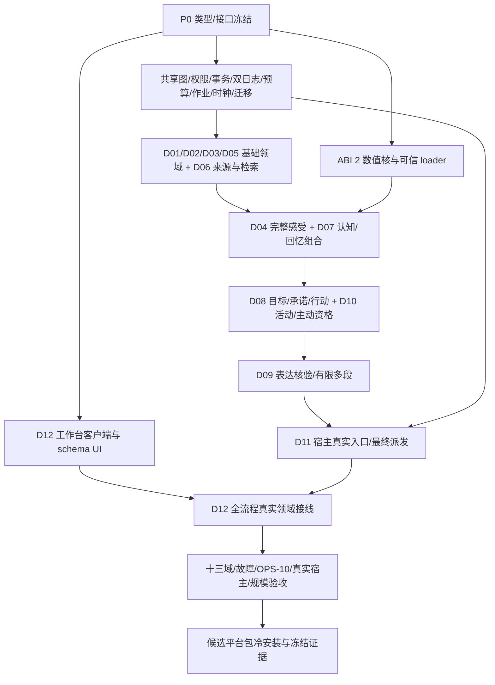

# embodiment-3.0.0-alpha1 实施架构闸门

2026-09-23 原冻结稿，2026-09-27 增补 D13。状态：**实施合同设计，尚未实现或通过产品验收**。用户已明确 alpha1 是完整重型插件；开发适配器、少数域切片、静态工作台均不能以此版本交付。原 D01–D12 工程接口保留，D13 新增短期上下文接口见[十三域耦合总装](../../architecture/sylanne-3-thirteen-module-coupling.md)；本文件不授权推送、合并或发布。

依据：[设计索引](../../architecture/sylanne-3-design-index.md)、[公共合同](../../architecture/module-collaboration-contracts.md)、[联合验收](../../architecture/sylanne-3-integration-acceptance.md)、[62 项覆盖](../../architecture/sylanne-3-requirements-coverage.md)、[旧账](../../../rewrite/REQUIREMENTS.md)、D11/D12 主稿与合同。后续明确方向优先，例如 D04 连续混合情绪取代旧五阶段状态机。

## 1. 基线与唯一运行路径

本次源码读取确认：`main.py` 创建 Store/NativeKernel，经 Application→Engine 运行显式 `/sylanne3` 开发路径；Engine 自称 semantic fixture。GraphStore 已有同 namespace 多 Owner/CAS/失效基础，但 TypeSpec 缺领域能力，作业/预算/恢复尚未形成完整协调器。native.py 从 `rewrite/native/target` 搜索 ABI 1，限制 256 维线性核。上述组件可复用经过验证的机制，不能直接换名成为完整产品。

目标路径：`main.py → RuntimeContext → Ingress/D06 source → D03/D07 按需协调 → 各领域合法候选 → DomainBundle 原子采用 → D08 行动资格 → D09 表达蓝图＋按用途 D13 短期片 → D11 模型外送/核验后 final admission → 唯一 dispatcher → 观测来源/领域结算`。D12 通过同一命令与投影接口工作。每轮不强制遍历十三域，启动目录必须注册十三域真实能力；D13 后台压缩模型调用不递归取 D13。生产入口不得调用旧 Store/Engine fixture 或退役核心作为降级路径；历史代码只作参照。

一份 SQLite 业务权威图，七类图是同源视图；领域不能新建可写状态库。独立删除/执行日志与激活权威保存恢复约束，不能成为第二份领域真值。GraphStore 兼容层必须封住继承 Store 的非类型化写入口，所有生产写入通过协调器能力检查；内层 SQL 只供指定基础设施写者使用。

## 2. P0 公共类型与调用合同

以下名字和字段是实施版本 `sylanne.runtime.v1`；现有 `dXX.contract.v1` 继续作为领域协议版本。P0 写者先提交可导入类型、Protocol、序列化器和 schema hash，其他工作包消费这些定义，不复制同名 DTO。未知字段/schema、NaN/Inf、跨 namespace 隐式写入、同 ID 异摘要均拒绝。

| 公共类型 | 必需字段 / 不变式 |
| --- | --- |
| `NamespaceId / Owner / AtomRef` | namespace=(bot_id,persona_id)；复用 Owner 五类及 AtomKey 规范身份；AtomRef=(key,revision)，缺失键 revision=0。会话不构成角色长期 namespace。 |
| `OperationIdentity` | activity_id、effect_id（无副作用可空）、attempt_id、phase、operation_id、canonical_input_digest；调用另有 call_id，派发另有 dispatch_id/generation。技术重试复用原 operation；换 attempt 不换 activity/父预算。 |
| `AuthorityContext` | 服务端认证 actor、issuer_domain、capability_ref、namespace、purpose、audience、provider_policy_ref、activation_generation、worker_fence（非 worker 可空）；字符串域名不是写者凭证。 |
| `VersionGuard` | 完整 read_versions（含缺失键）、query_epochs（含负查询范围）、access/delete epochs、catalogue/scheme/operator/policy versions、source grant refs、相关 focus/resource lease versions。 |
| `SourceQualification` | source refs/family、occurred/learned 时间、内容 reality、evidence eligibility、subjective confidence、内部活动 actuality 分列；authored/simulated 不升级外界事实。 |
| `DependencySet` | current invalidation、historical provenance、association、numeric coupling 四类边分别保存；CAS read-set 独立。全部内容引用进入访问/删除闭包。 |
| `CommandEnvelope` | schema、OperationIdentity、AuthorityContext、VersionGuard、SourceQualification、parent budget lease、deadline、causation；所有域命令复用。 |
| `DomainProposal` | domain、schema/hash、envelope、typed writes、dependencies、contribution keys、required bundle parts；领域 validator 签发进程内能力引用，客户端不可伪造。 |
| `DomainBundle` | envelope、各域 validated proposals、必要 experience/choice、D02 settlement、D11 cost settlement、幂等消费、持久 jobs/outbox；相同 namespace 原子提交。 |
| `CommitReceipt` | status、operation/digest、activity/effect、commit_seq、read/write versions、invalidated epochs、ledger/outbox refs；unknown 返回 pending_confirmation 并查询原 operation。 |
| `ProviderDescriptor / CheckReceipt` | provider/schema hash、owner capability、用途/平台/取消/幂等/费用/恢复能力；check kind、subject/action/purpose、输入版本、coverage、结果、有效期、issuer。部分覆盖不可冒充 pass。 |
| `DomainProvider` | `descriptor; register_types(); validate(proposal,snapshot); compile_scheme(draft,snapshot); project(query,snapshot); invalidate(refs); cleanup(plan)`；领域检查者另注册 `check(request,snapshot)`。校验不能偷偷发网或改图。 |

公开端口（同步数据库操作由受限 worker 承载；下面 async 表示宿主不阻塞）：

```python
async def read_snapshot(ctx, query) -> SnapshotResult: ...
async def prepare_bundle(envelope, proposals) -> PreparedBundle: ...
async def commit_domain_bundle(bundle) -> CommitReceipt: ...
async def get_operation(ctx, operation_id) -> OperationReceipt: ...
async def reserve_and_schedule(envelope, resource_quote, job) -> ScheduleReceipt: ...
async def invoke_model(envelope, model_request) -> CallReceipt: ...
async def admit_dispatch(envelope, intent, checks, payload_ref) -> DispatchClaim: ...
async def execute_and_observe(claim) -> ExecutionReceipt: ...
async def invalidate_or_erase(envelope, plan) -> CleanupReceipt: ...
async def migrate_backup_restore(envelope, plan) -> MigrationReceipt: ...
```

`SnapshotResult` 包含一致快照/游标、coverage/missing reasons、索引水位和完整 VersionGuard。`PreparedBundle` 只是候选；commit 必须在锁内重验，不能把 prepare 当资格缓存。通用错误包含 code、phase、retryability、operation_id、过滤后的定位、保留工作与恢复动作；事务状态、作业状态和外部观测状态用不同枚举。

### P0-A 事务与权限

唯一协调器串行化撤权、删除屏障、最终采用与最终出站准入。同 namespace 允许跨 Owner；跨角色用 D06 transfer。事务内重新核验写者、正/负读集、来源闭包、所有 epochs、方案、预算与 fencing；全部必要领域输出、经历、费用、贡献去重、outbox 全有或全无。模型/FFI/网络在事务外；已发生费用即使候选被拒仍由独立幂等结算 bundle 入账，不因候选回滚而丢失。D06 C04 回忆组合与 D07 C04 普通认知分别组织必需写集，不能双计体验。

2026-09-23 助手架构裁决（实施默认，尚非产品验收）：v2 首次 D06 宿主入站收敛为 `GraphWorker` 上一个同步命令、一个 Authority write fence、一次业务 SQLite 提交。受信宿主事实先作静态资格检查；在可能成功的 Authority begin 前持久化同一操作的输入指纹、规范接收时间、安装策略/预算授权、原 anchor 与图版本、固定 fence 身份。业务事务内共同提交 D06 来源及访问、首次观察/签发、D02 quote 与 D11 预留和编码 job/outbox、图事件、操作与 fence 收据、恢复版本。已签发的 root grant 经核对后复用，不为同一 lease 隐式增发 grant；生产 v2 不接旧的多次写入式入站路径。

SQLite 与远端 Authority 并非同一原子事务。已确认回滚且无业务收据、原图版本未变时，先持久记录 `rejected_no_commit`，再用原 fence 身份完成释放；提交或远端响应结果未知时保持原 intent 和 fence，按原操作查询恢复，不创建新 attempt。普通 `DomainBundle` v2 写已有确定性拒绝释放与提交恢复的局部实现；真正宿主入站尚未接通，不能将本裁决写为 `product_ingress` READY。

D08 行动 schema 固定 RequiredCheck 集，D06 装配 D03/D05/D06/D08/D11 提供者；适用社会角色必须有 D03 RoleBindingResolution，主动联系再有 D10 ContactPolicyCheck。消费者不得删检查项。D09 只产核验后的有限段；生产 final admission 不能被 UI、模型工具调用或自由文本绕过。

### P0-B 删除与独立恢复锚

`DeletionIntent=(namespace,seq,operation_id,scope/closure roots,epoch,policy,phase)`；D06 定义删除语义，D11 耐久执行。先独立日志 fsync，再封锁读取/外送/采用/投递，再返回 accepted；日志中 pending intent 也立即阻断。清理覆盖图历史、派生、索引、提示/模型缓存、jobs、草稿、实验、诊断、导入导出与受控备份，分面回执；外部下载不能声称撤回。

`RestoreAnchor=(authority_id,namespace,activation_generation,deletion_seq,execution_seq,revocation_epoch,proof)`。业务快照携带所需最低水位，恢复还须向独立权威取得当前最新水位并验证日志连续性；从快照自身 max(seq) 或同包标志读出“最新”无效。普通恢复不能覆盖锚。锚存储由安装级权限保护并排除普通业务恢复；整机/全部锚一起回滚不能靠本地文件自证，须可验证外部/迁移权威证明，否则隔离、无内容诊断。实现必须声明故障模型，禁止虚构软件能抵抗任意磁盘回滚。

宿主集成修正（2026-09-23）：受控 AstrBot 4.28.1 没有可供插件调用的受信 `get_trusted_service` 入口，不能把它列为 stock 冷安装先决 API。产品拓扑改为普通 AstrBot 插件内的 `AuthorityClient` 连接单独部署且经管理员配对的 Sylanne Authority；未配对时只有安装向导/无内容诊断，不读取角色内容、不接管消息。Authority 可由用户自托管，统一签发删除、执行、激活、恢复各自序号/日志头及当前资格；源、目标宿主必须连接同一权威才允许搬迁。配对凭据和服务身份经独立管理员渠道确认，聊天配置不能自报公钥、manifest hash 或代际为真。发行者包签名根与安装权威身份分离。本机伴随服务若要形成账户/文件权限隔离，须独立账户与显式系统安装；同 UID 子进程或另一个文件夹不构成该边界，也不能抵抗整机回滚。当前 alpha1 的整机回滚防线以前提“外部 Authority 未一起回滚”为准；权威自身恶意/同步回滚超出保证范围。离线或权威不可达时隔离，不能用旧证明续服。角色迁移可支持，Authority 自身迁移不列首发要求。

Authority v1 的内容 permit 不能冻结执行日志头，且当前本地桥能在其他 permit 期间追加日志；生产接线必须先通过 [Authority v2 耐久栅栏合同](authority-v2-fence.md) 的追加前栅栏、两阶段 pending mutation 和统一锁序验收。只加恢复时点查询或提交前 CAS 不足以解除此阻断。

### P0-C 外部执行与恢复约束

`ExecutionRecord=(namespace,execution_seq,effect_id,operation_id,command_digest,dispatch_generation,activation_generation,admission_ref,phase,observation,RecoveryConstraintFootprint)`，准备与观测只追加。Footprint 必须包含稳定 activity/effect、外部幂等/查询引用、冲突域键、适用 communication_action/contact/有限段摘要、对象无回应闸门/配额桶和时窗、D02 reservation/component 与待核实上界、D11 父预算/已用及待核实额度；由各领域验证且不存不必要原文。

派发次序：业务 admission/claim 原子登记 → 独立 journal 准备与足迹耐久 → 验证两面收据、当前 generation/fence/授权 → 平台交接 → 独立追加观测 → 幂等业务结算。未 journal 不发送；任一窗口崩溃恢复先核实，准备日志不能证明未发送。平台不支持幂等/查询时 unknown 保留，不能新 ID 重发；不承诺外部 exactly-once。

旧库恢复在服务前合并所有准备/unknown/观测及限制足迹，按 contact 只恢复一次占用；时窗过期不解除无回应闸门。仅有 effect 黑名单不够，必须挡新 ID 绕过对象/预算约束。足迹无法定位限制域则挡 namespace 新派发，namespace 无法定位则隔离。删除可净化日志内容；无法合法保留定位键时扩大阻断，不保留私密原文维持可用。

多段冻结一个 communication_action/contact 与有限 segment/effect 清单，首段 admission 原子占联系配额，后段逐次现行核验。任一段交接/unknown 保留占用；零段交接且全部可证未执行才可释放。

### P0-D 预算、持久作业与时钟

`BudgetLease=(id,parent_id,namespace,limits,used,reserved,unconfirmed,version)`；真实维度为前台时限、CPU/内存、模型 token/货币、后台积压/最迟服务。金额含 currency，未知费用保守占用，不写零。D02 `ResourceReservation` 独立记录 gross/encumbered/available/shortfall 与 call/component 去重；角色区间取实际片段并集。所有子任务继承父账，失败/重试/精修不重置；仅释放可证未用且已撤销执行资格的部分。

`PersistentJob=(identity,snapshot_ref,phase,continuation,wake_condition,deadline,budget_ref,resource_ref,operator_versions,lease_holder,fence,cancel_epoch,usage)`；waiting 不占 worker，超时/取消未实际退出仍占槽；失租迟到结果拒收。续接先查原收据和输入合法性。公平按宿主租户与 D07 注意两层分别实现，队列、批量、FFI、存储都有背压。

`CharacterClockMapping=(id,version,wall_origin_utc,character_origin,rate,valid_interval,policy_ref)` 由 D10 提案、D11 唯一签发；D03 解析外部时区/精度，D02/D04/D07 共用映射。`ExecutionSlice` 记录真实执行区间；物理/生活时间、commit/event seq、numeric iteration 分列。deadline 保存 UTC/floating rule/约定时区，monotonic 超时值不可跨进程直接复用；重启按持久截止及新单调时钟重建剩余时限，时钟不可信则延期。离线无观测不补造经历。

v2 首次入站的实施默认：管理员安装资料分别登记时钟来源/误差与编码工作的相对截止时长、单次资源上限、资源/快照引用；不在聊天配置中填授权，也不臆造数值。配对 Authority 只为已登记且健康的时源返回带安装身份的 UTC 样本；mTLS 证明服务来源，时刻准确性仍取决于管理员对该时源的实际管理。接收端用样本误差与往返时长形成保守 UTC 上界，以首次合格样本冻结 `learned_at`、绝对 UTC 截止和策略摘要；D02/D11 在同一入站事务内使用同一受信 UTC 上界校验期限。重启保留冻结值，用新样本重建本进程单调截止；缺配置、缺样本或超出误差界均保持入站 HOLD。此段为接线合同，现有安装时钟配置与 RPC 的局部代码不构成真实授时或产品验收。

W01 首次 ingress 的 v1 兼容裁决（2026-09-23）：已经签发的 `CommandEnvelope.monotonic_deadline` 仍保留原数值参与持久摘要，但只作历史身份字段，不得在另一进程作为现行截止资格。重试不得重写 envelope、已封存 bundle、D02 quote 或其签名。未提交续接必须在当前激活与内容栅栏内，从原 UTC 截止及受信 UTC/单调时钟重新建立进程内截止绑定；绑定不进入摘要，时钟无可信证据或截止已过则延期/拒绝。已提交重复先查原操作收据；未提交跨激活代际继续拒绝，直到另有版本化的候选与执行授权分离合同。取消与最终采用须由协调器串行化，过期/取消不得清除首次观察和原幂等身份。此段是实现约束，跨重启/跨平台资格仍以实际故障注入和冷安装收据为准。

### P0-E 目录、升级与唯一迁移

目录冻结 writer/type/schema/hash、边类、operator/参数范围、迁移器与兼容区间。迁移影子库经完整来源/权限/域校验后切换活跃指针，旧 writer fence 失效。旧数据仅作为迁移候选，不运行旧核心；字段/来源丢失必须预览，不能把旧好感转换成已证信任。

`MigrationAuthority` 接口：`current(namespace) → ActivationProof`、`begin_transfer(plan)`、`revoke_source(generation)`、`activate_target(proof,anchors)`、`recover_transfer(operation_id)`；一个权威持久序列化签发 generation。所有读、订阅、下载、模型外送、采用、写、发送及启动检查，不能只锁写。离线搬迁凭据由同一权威唯一消费，不允许双方凭超时复活。默认采用保持可达的安装级权威；搬迁部署须能证明源/目标均受该权威约束。不能满足则该次搬迁隔离，完整搬迁功能尚不算验收。

## 3. 数值核与发行布局

ABI 2 的必要性是新增 CSR/块因子非线性联合求解、可续接有界批、取消边界、完整误差/能量证书和容量能力查询。不能在 ABI 1 的稠密指针布局中偷换语义。新符号族采用 `sylanne3_v2_*`，显式 struct_size/abi_version、缓冲长度与所有权、status/continuation；禁止跨 ABI 传指针/续接对象。ABI 1 留在专项线性参照测试，生产 D04 必需能力拒绝用 ABI 1 满足。ABI 2 不是算法证明：必须落实 [数值合同](../../modules/11-runtime-numerics.md) 的联合正性/反对称结构、q 上界、舍入包络、时间缺陷、遗漏耦合边界、映射误差传播与读出区间。

数值实施裁决（2026-09-23）：普通 `f64` 迭代器只生成候选，独立向外舍入区间验证器重新计算完整非线性 AVF 方程、残差、能量及连续重建缺陷。首版覆盖完整耦合分量，局部裁剪与任意非线性参数映射可暂缓；不能把调用者自报的遗漏界或 Lipschitz 系数当认证。认证路径不调用精度未界定的 `hypot/exp/exp_m1`，采用有明确解析余项的区间超越函数；MPFR 仅作独立高精度参照，只有实测表明纯 Rust 区间过宽时再评估运行时后端与跨平台打包成本。2026-09-27 当前源码已能条件性报告 ABI2 fixed-block 区间数学能力，并在逐次独立验证成功时给出对应证书位；这只认证给定完整块的数学条件。D04 生产读出仍须由真实来源、图完整闭包、继承误差与产品采用资格签发，不能由能力位或单次证书直接解锁。近零差商、饱和、抵消、次正规数、`q` 临界、耦合遗漏与误差放大映射均须有独立反例验收。

建议并冻结以下运行资产路径（平台包仅含对应 target）：

```text
main.py / metadata.yaml / _conf_schema.json
rewrite/sylanne3/                 # 唯一 Python 产品实现
rewrite/sylanne3/_native/<os>-<arch>/ # dll/so/dylib 及必要依赖；canonical filename
resources/workbench/             # 新工作台构建输出
resources/catalogue/             # schema、算子目录、默认方案
resources/migrations/            # 受信版本化迁移资源
release-manifest.json            # 全文件 hash/大小/ABI/能力/兼容矩阵
LICENSE / THIRD_PARTY_NOTICES / SBOM
```

loader 仅解析经信任根验证的 manifest 和规范包路径；拒绝逃逸、摘要不符、错 OS/arch/libc/CPU/ABI。不搜 PATH/debug/target，不安装时 cargo build，不暗下载库。构建输出留在暂存资产，不把原生二进制提交源码树。完整插件的真实宿主纵向验收先在一处 Windows x86_64 环境完成；Linux x86_64 与 macOS 的本轮平台门主要是当前 Rust 原生核在对应系统编译、加载、通过原生测试并完成代表性求解。Linux arm64 与 macOS 的另一架构可继续做兼容探针，但不挡本轮交付。未跑完整宿主验收的平台要逐项标注证据边界；平台数量不缩减十三域产品能力。

发布名 `embodiment-3.0.0-alpha1`，产品 SemVer `3.0.0-alpha1`，schema/ABI 独立版本。Windows 是首个完整实机验收组合；Linux/macOS 原生核运行只证明数值组件兼容，不自动证明完整插件宿主行为。当前 metadata 的 AstrBot >=4.28.1,<5.0.0 / Python >=3.11 只是现有声明，不能继承为新产品通过；发包前必须冻结实际最低/受测宿主、Python、OS/CPU/libc 与必需能力矩阵，未支持组合启动前拒绝并诊断。约 10 MB 只作体积参考，记录压缩/展开/组成；不以删功能达标。

## 4. 实施依赖与整合顺序



箭头为**通过集成门**的依赖，非禁止并行编码。基础域可以依 Protocol 并行，但缺必需提供者返回 unavailable，不能用模拟成功解锁下游验收。D08 与 D10 协同接口双向，但领域事务不产生即时无限调用环；D10 提案由 D08 采用，D11 执行后观测另起事件。D04/D07 及回忆反馈也经冻结快照/组合提交，只有数值声明 SCC 使用联合求解。

## 5. alpha1 必过门与可后续校准

| 门 | 发包前所需实际证据 |
| --- | --- |
| G0 基础 | Python/Rust/前端编译；P0 权限/CAS/负查询、取消/背压、事务崩溃、双日志旧备份恢复、fencing 与迁移读屏障。基线编译不能代替这些。 |
| G1 十三域 | D01–D13 各主稿/合同/验收逐项实现映射；真实域注册且每域有可观察行为后果。旧需求账的 62 项无未实现行，新增 D13 A01–A08 独立验收且不伪装成旧账第 63 项；旧机制 REVISED 用覆盖矩阵新场景，不能跳过保留需求。 |
| G2 数值/语义 | D11 T12–T23 等独立参考、舍入/时间/截断反例及参数切换；D04 混合情绪与 D06/D07 资格/体验分离；固定输入单域干预确实影响声明的行为。数值通过不代替语言/人物效果。 |
| G3 联合恢复 | S01–S16 与完整 OPS-10 顺序轨迹；跨日/多会话延续；更正、私聊撤权、多段 unknown、离线、删除、旧备份、迁移各有事件/版本/实际收据与负例。fixture 与真实宿主证据分列。 |
| G4 工作台 | 安装→创建/绑定→真实对话→观察/纠错→隔离实验→分享/备份/迁移→升级失败恢复→删除/停用/卸载，D12 T01–T40；无静态替身，键盘/窄屏/读屏关键路径实测。 |
| G5 宿主/平台 | 一处 Windows x86_64 实机完成干净环境根入口启动、真实私聊/群聊/附件/工具、重连/重启/热卸载；ack/delivered/read/unknown 分开。Linux 与 macOS 本轮主要验证 Rust 原生核在目标系统构建、加载、通过原生测试和代表性求解；未做完整插件宿主验收须明确标记。模型能力/凭据/权限正确；平台测试无收据不算通过。 |
| G6 规模/费用 | 1k/10k/100k 来源、重复/纠错/长承诺；事前固定硬件/模型/输入/预算及可用性阈值，记录 P50/P95、峰值、索引追赶、事件循环/积压/每日费用。OPS-09 四对照与消融至少完成冻结验收集，不能整体延期。 |
| G7 构件 | 实际候选包 hash/manifest/版本/ABI/许可/SBOM/体积/排除清单；无 Rust 环境冷安装、加载和升级恢复；支持矩阵只填有证据组合。主入口到全部域与工作台 trace 可复核。 |

可以后续继续：扩大语料/用户样本、改进检索与语义质量、调参、细调批大小/延迟/内存、长于既定验收窗口的持续观测、新增平台资格。不能后移：上述覆盖、资源有界性、数值条件、真实宿主与完整产品路线、初次规模/对照测量；alpha 并不豁免这些要求。样本规模与阈值必须在执行前登记，不能看结果后降低。

候选构件可在开发中本地构建供验收，只有 G0–G7 通过才把**该确切 hash**标记为 alpha1 可交付；修改后按受影响门重新验证。当前没有正式发包证据，不提前改发布宣称。推送/PR/合并/公开发布仍遵循用户后续明确授权。

## 6. 唯一写者与当前阻断

文件写者、批次和交接门见 [task_plan](task_plan.md)。跨包改接口先由 P0 写者版本化变更，再重新对齐消费者，禁止各自兼容补丁。所有写者只改获派路径，不进入历史模块工作树，不清理既有脏改动。

当前阻断是完整领域与基础设施未接线、ABI 2/新工作台/目标构件未验收，以及目标宿主/模型预算/平台集/信任根和可验证迁移权威需要在相应集成门前落地。它们不阻止按 P0 编码，也不能被默认为已存在。主任务回报现有 Python compileall 与 cargo check 通过，仅作历史基线记录；本次战略子任务未执行软件或现场验收。
